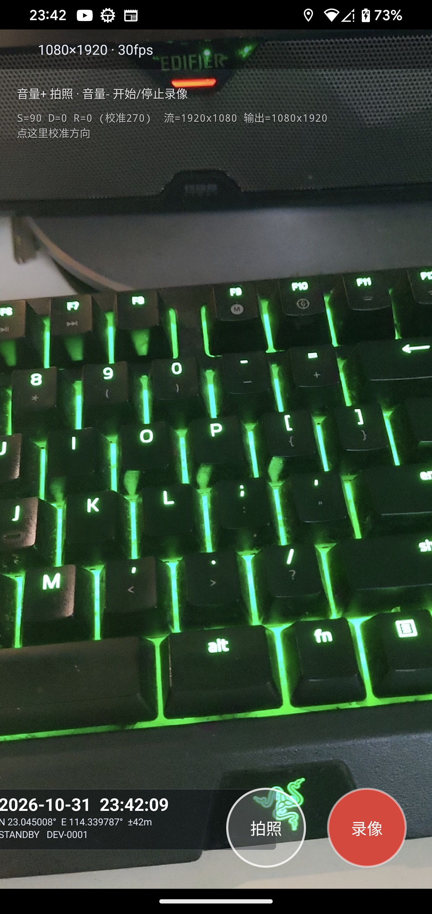
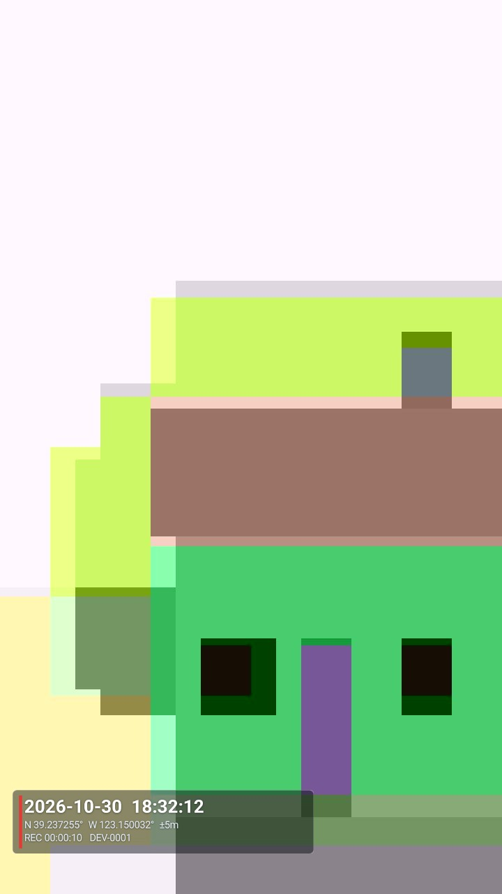

# 执法记录仪（BodyCam）

Kotlin + Camera2 + OpenGL ES（C++/NDK）+ MediaCodec 实现的安卓视频执法记录仪。

视频画面不经过 CPU：相机帧以 OES 纹理进入 GPU，水印在同一个 GL 管线里合成，
直接送进 H.264 硬件编码器的输入 Surface，所以水印是「烧」在视频里的。
录像按 30 分钟自动切片，切片过程编码器不重启，因此不丢画面。
照片同样会烧上水印，并且会按 EXIF 方向把像素真正转正。
可选开启**预录**：按下录像键之前的画面与声音也会被保存下来，与后面的录像合成**同一个文件**
（缓存 5 / 10 / 20 / 30 秒可调）。

<p align="center">
  
  
</p>

> 左：实时预览（水印左下角，音量键控制）；右：拍照输出，方向已转正、水印已烧进画面。
> 录制样例：[docs/sample_video.mp4](docs/sample_video.mp4)（含音轨）

---

## 一、功能对照

| 需求 | 实现 |
| --- | --- |
| 音量+ 拍照 | `MainActivity.dispatchKeyEvent` → `KeyRouter` → `capturePhoto()` |
| 音量- 开始/停止录像 | 同上 → `toggleRecording()` |
| 息屏不中断录像 | `KeepAliveService`（`camera\|microphone` 前台服务 + `PARTIAL_WAKE_LOCK`） |
| 录像中拍照 | Camera2 单次 `capture()`，同时带 JPEG 与预览两个 target，不打断录像流 |
| 时间水印（OpenGL + C++，低功耗） | `cpp/renderer.cpp` 合成 OES 纹理 + 水印纹理，EGL 直出到编码器 |
| 30 分钟自动分段 | `SegmentRecorder`：编码器不停，只换 MediaMuxer |
| 照片烧水印 | `PhotoWatermarker`：EXIF 转正 → 叠水印 → 重编码 |
| 预录（5/10/20/30 秒可调） | `PreRecordBuffer` 常驻编码 + 环形缓存，按键瞬间交接进正式录像（见「八点五」） |
| 预录开启提示 | 主界面右上角**黄点**（`preRecordDot`），设置页可开关 |

---

## 二、数据流

```
                     ┌──────────────── 渲染线程（C++） ────────────────┐
Camera2 ──SurfaceTexture──▶  OES 纹理 ──┐                              │
                                         ├──▶ GL 合成 ──┬──▶ 预览 SurfaceView
水印 Bitmap ──RGBA 纹理 ─────────────────┘              │
                                                        └──▶ MediaCodec 输入 Surface
                                                              （预录/录像共用同一个编码器）
                                                              │
                                              ┌───────────────┴───────────────┐
                                        视频编码线程                     音频编码线程
                                     (H.264, 输出 ByteBuffer)        (AudioRecord → AAC)
                                              └───────────────┬───────────────┘
                                                      MediaMuxer（每 30 分钟换一个）
```

要点：

- **零 CPU 拷贝**：相机帧全程停留在 GPU 纹理里，`glTexImage2D` 只用于上传那张小水印图。
- **一次采样、两处输出**：同一帧画到预览和编码器两个 EGL Surface，不做二次解码/编码。
- **预览与成片一致**：预览用等比缩放 + 黑边，看到的就是录进去的构图（含水印）。
- **分段不中断编码**：只在分段点换 muxer，编码器与相机全程不停。
- **预录与录像共用编码器**：空闲时帧流向预录 Surface，按下录像键时把渲染目标切到
  正式录像 Surface（就是该编码器自己的输入 Surface），编码器不重启、不丢帧（见「八点五」）。

---

## 三、目录结构

```
app/src/main/
├── cpp/
│   ├── CMakeLists.txt
│   ├── shaders.h            # 顶点/相机/水印 三个 GLSL ES 2.0 着色器
│   ├── renderer.h/.cpp      # EGL 上下文、三 Surface（预览/录像/预录）、GL 合成、方向补偿
│   └── jni_bridge.cpp       # JNI 入口：Surface→ANativeWindow、Bitmap→像素缓冲
├── java/com/dsh/bodycam/
│   ├── MainActivity.kt      # 界面、按键、拍照/录像调度、预录交接、水印节拍
│   ├── SettingsActivity.kt  # 设置页：预录开关 + 预录时长
│   ├── camera/CameraController.kt   # Camera2：预览流 + JPEG 流 + 录像中拍照
│   ├── record/SegmentRecorder.kt    # MediaCodec 编码 + MediaMuxer 无缝分段
│   ├── record/PreRecordBuffer.kt    # 预录：常驻编码器 + 环形帧队列 + 交接
│   ├── record/CodecSupport.kt       # 两个 recorder 共用的编码器/音频采集样板
│   ├── gl/WatermarkEngine.kt        # JNI 声明（与 jni_bridge.cpp 一一对应）
│   ├── gl/GlPipeline.kt             # handle 生命周期封装
│   ├── watermark/WatermarkPainter.kt    # Canvas 画时间/GPS/设备号（视频与照片共用）
│   ├── watermark/PhotoWatermarker.kt    # 照片：EXIF 转正 + 叠水印 + 重编码
│   ├── watermark/Telemetry.kt       # GPS
│   ├── service/KeepAliveService.kt  # 息屏保活
│   ├── key/GlobalKeyService.kt      # 可选：息屏也能用音量键（无障碍）
│   ├── core/KeyRouter.kt            # 按键去抖与分发
│   ├── core/SettingsStore.kt        # 预录设置读写 + 变更回调
│   ├── core/AppConfig.kt            # 所有可调参数集中在这里
│   ├── util/Rotation.kt             # Surface 旋转常量 → 角度
│   └── util/Storage.kt              # 文件落盘
└── res/                             # 布局（主界面/设置页）、主题、图标、无障碍配置
```

---

## 四、构建

环境：Android Studio（JDK 11+）、SDK 33、NDK `25.1.8937393`、CMake `3.18.1`。

```bash
./gradlew assembleDebug
# 产物
app/build/outputs/apk/debug/app-debug.apk
```

`local.properties` 里的 `sdk.dir` 换成你自己的 SDK 路径；换 NDK 版本时同步改
`app/build.gradle.kts` 的 `ndkVersion`。

文件输出目录（不需要存储权限，`adb pull` 方便）：

```
Android/data/com.dsh.bodycam/files/BodyCam/videos/VID_yyyyMMdd_HHmmss_part00.mp4
                                                  VID_yyyyMMdd_HHmmss_part01.mp4
Android/data/com.dsh.bodycam/files/BodyCam/photos/IMG_yyyyMMdd_HHmmss_SSS.jpg
```

`yyyyMMdd_HHmmss` 是**按键开始录像的时间**（不是预录起点），所有分段共用同一前缀，
`partNN` 递增。开了预录时，第一个分段的时长会比实际录像时长多出预录的那几秒。

---

## 五、按键与息屏

| 操作 | 效果 |
| --- | --- |
| 音量+ | 拍照（录像中也生效，闪光提示） |
| 音量- | 开始 / 停止录像 |
| 通知栏「停止录像」 | 停止并保存 |
| 右上角 ⚙ | 进入设置页（预录开关与时长） |
| 右上角黄点 | 仅表示「预录已开启」，与当前是否在录像无关 |

**关于息屏按键**：安卓在屏幕关闭时会把音量键交给系统去调音量，普通 Activity
收不到。本工程给了两条路：

1. 默认：音量键只在应用前台时有效；录像可以息屏继续，回到前台再按音量- 停止。
2. 可选：设置 → 无障碍 → 开启「音量键助手（息屏可用）」。开启后无障碍服务在系统
   分发前截获音量键，**息屏状态也能拍照/停止录像**。只有本应用在前台或录像中才拦截
   （`KeyRouter.armed`），其他时候音量键照常工作。

> 注意：无障碍服务属于高权限，上架应用商店通常需要说明用途；内部设备可以直接开启。

---

## 六、视频水印与功耗

- 水印内容：`日期 时间` / `GPS 经纬度与精度` / `REC 时长 + 设备编号`。
- 由 `WatermarkPainter` 用 Canvas 画成 ARGB_8888 位图（宽度 = 画面宽度 60%），
  **每秒重画一次**，通过 JNI 传给 GL 线程上传为纹理。
- GL 侧用 4 个顶点画一个带旋转的四边形，混合方式为预乘 alpha
  （`GL_ONE, GL_ONE_MINUS_SRC_ALPHA`），不产生离屏 FBO、不做回读。
- **方向只在纹理坐标上旋转**：几何顶点始终铺满视口，所以竖屏时把 16:9 的画面
  转 90° 填进 9:16 的帧里，像素不会被拉扁（早期版本旋转顶点，在非正方形视口里
  必然变形，已修正）。
- 预览与编码走**同一段 `drawScene()`**，所见即所得；不再依赖 MP4 的 rotation
  元数据，画幅本身就已经是正向的。

---

## 六点五、方向与画幅

界面上那行小字（`S=.. D=.. R=..`）就是方向计算的全部输入，`AppConfig.DEBUG_OVERLAY`
可关掉：

| 记号 | 含义 |
| --- | --- |
| `S` | 相机 `SENSOR_ORIENTATION`（多数手机是 90） |
| `D` | 当前屏幕旋转角（竖持 0，横持 90/270） |
| `R` | 实际使用的旋转角 = `(S - D + 校准偏移) % 360` |
| 流 | 相机输出尺寸，传感器方向，一般是 1920×1080 |
| 输出 | 实际录制画幅：**跟随屏幕方向**，竖屏 1080×1920，横屏 1920×1080 |

画幅只跟屏幕方向走，**不跟旋转角走**：竖着拿就永远是 1080×1920，
所以校准旋转角时画幅不会跟着跳成横屏。预览用 cover（铺满、可裁边）而不是
留黑边，所以竖屏下就是全屏竖屏画面。视频文件里没有 rotation 标记，任何播放器
都按正向显示。

**如果真机上预览/成片方向不对：不用改代码，直接点屏幕上那行小字。**

点一次校准角 +90°，在 `0 → 90 → 180 → 270` 之间循环，**只改变画面朝向，
画幅始终是竖屏**。转到画面正了就停：

- 最多点 4 次回到原点，不会越点越乱；
- 选择写进 `SharedPreferences`，重启不丢。

> 为什么不能自动：不同机型相机 `SurfaceTexture.getTransformMatrix()`
> 返回的矩阵不一样（有的带镜像，有的还含一次 90° 旋转），部分机型
> `SENSOR_ORIENTATION` 甚至报成 0/180，导致自动算出来的角度偏一档。
> 硬编码任何一边都会踩到另一边，所以把最后的校准交给现场，一次点选即可。

确认后想固化：把那个 `R` 值填到 `AppConfig.ROTATION_OVERRIDE`（`-1` 表示自动），
或者改 `MainActivity.DEFAULT_ROTATION_OFFSET`（默认已按本机实测设为 `270`，
也就是开箱即正向，不需要手动点；换机型再按需调整）。

---

## 七、照片水印

相机直出的 JPEG 方向在不同机型上行为不一致：有的只写 EXIF 标签，像素仍是横的；
有的直接把像素转正、标签还留着。所以 `PhotoWatermarker` **不盲信 EXIF**，
而是用「应用算出的旋转角 + 解码后的长宽」交叉判断：

1. 解码后仍是横向像素（`w > h`）→ 说明设备没转，按 `R` 转 90/270；
2. 解码后已经是竖向 → 说明设备已经转过，不再转（否则会转 180°）；
3. `R` 为 180 时直接转 180，`R` 为 0 时不动；
4. 在转正后的画面上按与视频相同的比例叠水印，再重新编码成 JPEG（质量 92），
   不保留原 EXIF —— 像素已经真正转正，留着标签会被播放器再转一次。

代价是每张照片一次 decode + encode（几十到一百多毫秒），在独立的单线程池里做，
不阻塞预览和录像。照片边长超过 4096 会自动降采样，控制内存峰值。

水印内容里的 `REC 00:00:12` 是拍照那一刻的录制时长，`STANDBY` 表示没在录像。

---

## 八、分段录制（30 分钟一片）

**为什么不用 MediaRecorder**：它一个实例只能写一个文件，到点必须 stop/start，
每次会丢几百毫秒画面和声音，执法记录仪不能接受这种空洞。

`SegmentRecorder` 的做法：

- 视频/音频编码器**全程只启动一次**，持续输出；
- 到 30 分钟时请求一个 I 帧（`PARAMETER_KEY_REQUEST_SYNC_FRAME`），
  拿到该 I 帧后关闭旧 muxer、开新 muxer，把这一帧作为新文件的第一帧写入；
- 两个线程共用一把锁保护 muxer，切换瞬间互斥；
- 每个分段的第一帧都是 I 帧，所以**任意一段都能独立播放**；
- 时间戳统一成「相对本次录制开始的微秒」，每段写入时减去该段的 base，
  所以每段都从 0 开始，音画不漂。

**代价**：切换时音频会丢弃约 1 帧（<100ms）；分段长度会比设定值最多多等一个 I 帧
（`KEY_I_FRAME_INTERVAL = 1`，即最多 +1 秒）。画面不丢帧。

---

## 八点五、预录（按下录像键之前的画面与声音）

执法场景里最关键的一刻，往往是掏设备、按下去之前那几秒。预录就是把这部分补回来。

**入口**：主界面右上角 ⚙ → 设置页「预录功能」开关 + 预录时长（5 / 10 / 20 / 30 秒）。
设置实时写入 `SharedPreferences`（`SettingsStore`），并回调主页面刷新。主界面右上角
有个**黄点**，亮着就表示预录已开启，与当前是否正在录像无关。

**做法**（`PreRecordBuffer`）：

- 预录开启时，App 在预览阶段就**常驻一套视频 / 音频编码器**，相机帧同时画进预览
  Surface 和预录 Surface（`renderer.setPreRecordWindow()`），编码结果只入内存，**不落盘**；
- 视频帧进环形队列，按**帧数**保留 `(bufferSeconds + 1) × fps` 帧，队头始终对齐到
  一个 I 帧，这样队首切出来的片段能独立解码；音频队列同步按时间窗裁剪；
- 按下录像键时调用 `beginHandover(seconds)`：取出对齐后的尾部切片交给
  `SegmentRecorder`，**视频编码器原样移交给正式录像继续用**（不重启、不丢帧），
  音频编码器重建并把交接区间内的 AAC 帧先写进去；
- 所以成片是**一个文件**，等于「预录 N 秒 + 之后的录像」，时间零点就是交接的第一帧；
- muxer 尚未就绪（新音频编码器还没吐 `outputFormat`）期间，实时视频帧先缓存在
  `pendingRealtimeVideo`（上限 60 帧）里，就绪后按序补写，避免开头出现空洞花屏。

**代价**：预录开启时编码器与音频采集全程在跑，耗电和内存占用会增加。每秒内存开销约等于
`码率/8`，30 秒 @12Mbps 的视频约 45MB，加上音频不到 50MB。所以设置页里默认是关的，
并提供 5 秒这个省资源的档位。

**注意**：录像期间预录缓存是停掉的（帧要留给正式录像编码器），停录后再自动恢复；
转屏导致输出画幅变化时也会重启一次缓存，避免尺寸失配。

**与分段的配合**：交接后进入正常的 `SegmentRecorder` 流程，30 分钟切片规则不变，
预录内容只出现在第一个分段里。

---

## 九、常改参数（`core/AppConfig.kt`）

| 参数 | 说明 |
| --- | --- |
| `SEGMENT_SECONDS` | 分段长度，默认 `30 * 60`；调成 8 秒即可快速验证切片 |
| `VIDEO_FPS` / `VIDEO_BITRATE` | 帧率与码率（默认 30fps / 12Mbps） |
| `AUDIO_SILENT_THRESHOLD` | 录音峰值低于此值提示「基本没录到声音」（默认 50 / 满量程 32767） |
| `WATERMARK_WIDTH` | 水印宽度占画面比例（0.60） |
| `WATERMARK_LEFT` / `WATERMARK_BOTTOM` | 水印左下角边距（0.045 / 0.045） |
| `DEVICE_ID` | 水印上的设备编号，可改成警号 |
| `KEEP_SCREEN_ON` | true 则常亮；默认 false，允许息屏继续录 |
| `DEBUG_OVERLAY` | 左上角显示 `S/D/R` 与流/输出尺寸，定位方向问题用；正式使用建议关掉 |
| `ROTATION_OVERRIDE` | 强制旋转角，`-1` 为自动；真机方向差 90° 时填相反角度 |

画幅不写死：`R` 为 90/270 时输出 1080×1920，否则 1920×1080；
相机流尺寸由 `CameraController.probe()` 从设备支持的 `SurfaceTexture` 尺寸里挑
（优先 1920×1080）。

---

## 十、已知限制

1. **厂商省电策略**：部分国产 ROM 会在息屏后冻结后台进程。需要在系统设置里给本应用
   开「自启动 / 后台运行 / 忽略电池优化」，否则再好的代码也保不住录像。
2. **相机被系统回收**：息屏且未录像时，系统可能断开相机。本工程在 `onResume` 里调用
   `ensureOpen()` 自动重开；如果 ROM 更激进，可把前台服务改成「打开应用就常驻」。
3. **Android 14+**：若把 `targetSdk` 提到 34，前台服务必须声明
   `FOREGROUND_SERVICE_CAMERA` / `FOREGROUND_SERVICE_MICROPHONE` 权限，
   并且要在用户可见时启动。
4. **音频**：单声道 48kHz / 128kbps；需要双声道改 `record/CodecSupport.kt` 里的
   `CHANNELS` 与 `AudioFormat.CHANNEL_IN_MONO`（两个 recorder 共用这一份）。
5. **MP4 尾部索引**（已修复）：早先用传统 MP4，`moov` 要等 `stop()` 才写，
   进程被强杀当前这段会整体报废。现已改用 **fMP4（分片 MP4）**，moov/mvex
   前置、数据按 `moof+mdat` 分片自包含——强杀后已写入的部分仍可直接播放，
   只有最后不到 1 秒可能丢。副作用：输出文件总时长/时长从不更新，极个别
   播放器会显示 `--:--`（进度条仍在走），拖拽到末尾也不额外补帧。若需
   精确时长，可在文件关闭后用 `MediaMetadataRetriever` 重新写入或设
   `KEY_MEDIA_INFINITE`。
6. **方向上报不规范的机型**：极少数设备的 `SENSOR_ORIENTATION` 与实际成像不符，
   表现为画面整体差 90°。开 `DEBUG_OVERLAY` 看 `R`，用 `ROTATION_OVERRIDE`
   填相反角度即可（画幅仍然是竖屏），不需要改算法。
7. **预录的内存与功耗**：预录开启期间视频/音频编码器常驻，30 秒缓存约占 45MB 内存
   （按 12Mbps 估算），同时持续耗电。低配机或长时间桌面放置时建议用 5 秒档或关闭。
8. **预录只在预览阶段生效**：预录内容都落在当次录像的**第一个分段**里；如果录像中途
   因分段换成第二个文件，预录部分不会出现在新分段中（语义上也不需要）。
9. **未做**：断点续录、加密存储、Wi-Fi 回传、GNSS 北斗原始数据。

---

## 十一、调试建议

- C++ 日志 tag：`BodyCamGL` / `BodyCamJNI`；Kotlin 侧分段日志 tag：`SegmentRecorder`，
  预录日志 tag：`PreRecordBuffer`
  ```bash
  adb logcat -s BodyCamGL BodyCamJNI SegmentRecorder PreRecordBuffer
  ```
- 验证分段：把 `AppConfig.SEGMENT_SECONDS` 临时改成 8，录 30 秒，`adb pull` 后应该
  得到 3~4 个 `partNN.mp4`，每个都能单独播放。
- 验证预录：开启预录（10 秒），在预览界面停留 15 秒以上再按音量- 开始录像，录 5 秒后
  停止。第一个分段的**总时长应约为 15 秒**（10 秒预录 + 5 秒），开头画面能正常播放，
  不应出现花屏或从中间开始解不出来。日志里可核对 `PreRecordBuffer` 的
  `slice: queue=N -> M frames, key=..., span=Xms` 与 `SegmentRecorder` 的
  `wrote N handover video frames`。
- 想确认水印确实烧进视频：录 10 秒后 `adb pull` 到电脑，用播放器打开暂停看左下角；
  或用 `ffprobe` 核对分辨率、码率、每段的 `rotation`。
- 改 JNI 方法签名时，`WatermarkEngine.kt` 与 `jni_bridge.cpp` 必须同步改，
  否则运行时抛 `UnsatisfiedLinkError`（编译期不会报错）。

---

## 十二、实测记录（模拟器：Pixel 竖屏自然方向 / API 33 / x86_64）

| 验证项 | 结果 |
| --- | --- |
| 启动、Native 库加载、EGL/GL 初始化 | 通过（EGL 1.4，`recordable` 配置，OES 纹理正常） |
| 方向计算 | `S=90 D=0 R=90`，输出自动切成 720×1280（竖屏） |
| 预览 | 通过：竖屏满屏、无拉伸，构图与系统相机一致 |
| 录像 | 通过：编码尺寸 720×1280，`tkhd` 旋转矩阵为单位阵（无 rotation 标记） |
| 录像中预览 | 已修：此前会黑屏（预览表面重建被编码器阻塞），现正常出图 |
| 分段（临时设为 8 秒） | 通过：20 秒录出 3 段，时长 8.04 / 8.09 / 4.38 秒 |
| 分段音画对齐 | 通过：每段音视频轨时长差 0.03~0.09 秒（AAC 帧粒度） |
| 照片水印 | 通过：720×1280 正向、水印叠加位置正确、`REC` 计时正确 |
| 空分段清理 | 已加：一帧未写入的段会被删除，不留几 KB 空壳文件 |
| 音频时基 | 改用 CLOCK_BOOTTIME（与相机帧时间戳同一时基），修复机器休眠后音轨 0 样本的问题 |
| 空闲水印时钟 | 常驻刷新，不再只在录像时走 |
| 切后台再回前台 | 已修：`renderFrame` 在无绘制目标时也要 `updateTexImage()` 消费相机帧，否则缓冲队列堵死、回来黑屏；同时回前台重建预览会话 |
| 预录交接 | 通过：预录 10 秒 + 录 5 秒，成片约 15 秒，单文件、开头可正常解码 |
| 预录花屏 | 已修（待真机复验）：三处根因——(1) 编码器 PTS 回退到 `steady_clock` 与相机 `CLOCK_BOOTTIME` 混源；(2) 环形队列按时间窗裁剪会切在非 I 帧上；(3) muxer 就绪前的实时帧被直接丢弃。现改为 PTS 只在相机时间戳有效时出帧、按帧数裁剪并对齐关键帧、就绪前缓存至多 60 帧按序补写 |
| 预录退出释放 | 通过：关闭预录或退出页面会销毁预录编码器与 `AudioRecord`，无明显常驻占用 |
| lint | 0 error |

> 模拟器的虚拟相机画面本身会缓慢变化，无法作为方向基准；方向的最终判定
> 以真机为准。若真机上整体差 90°，按「六点五」点那行小字校准即可。

---

## 十三、目录与代码规范

- 全部 Kotlin，包名 `com.dsh.bodycam`，按职责分包：`camera` / `record` / `gl` / `watermark` / `service` / `key` / `core` / `util`
- 缩进 4 空格、UTF-8、LF；规则见 `.editorconfig`、`.gitattributes`
- 不引入任何第三方依赖（无 AndroidX），减少体积与构建变量
- 提交前建议跑一遍：

  ```bash
  ./gradlew assembleDebug lintDebug
  ```

---

## 十四、许可证

本项目采用 [MIT License](LICENSE)。


