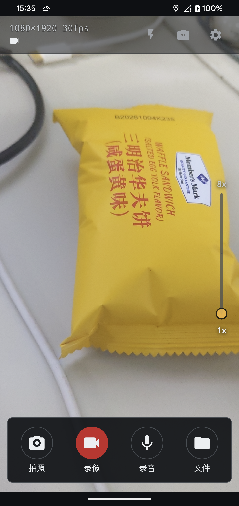
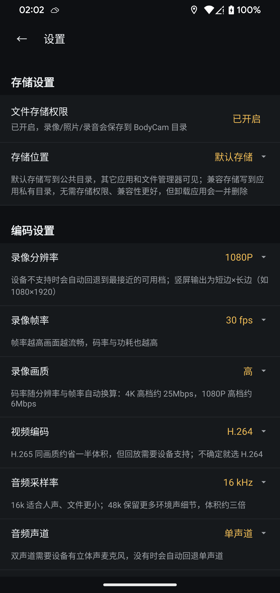

# 执法记录仪（BodyCam）

Kotlin + Camera2 + OpenGL ES（C++/NDK）+ MediaCodec 实现的安卓视频执法记录仪。

视频画面不经过 CPU：相机帧以 OES 纹理进入 GPU，水印在同一个 GL 管线里合成，
直接送进 H.264 硬件编码器的输入 Surface，所以水印是「烧」在视频里的。
录像按 30 分钟自动切片，切片过程编码器不重启，因此不丢画面。
照片同样会烧上水印，并且会按 EXIF 方向把像素真正转正。
可选开启**预录**：按下录像键之前的画面与声音也会被保存下来，与后面的录像合成**同一个文件**
（缓存 5 / 10 / 20 / 30 秒可调）。

另外提供**独立录音页**：只采声音、不开相机，上半部是实时波形，下半部是一个
「开始 / 停止」二合一按钮；录音同样按 30 分钟自动分段，编码器不停、只换封装文件。

<p align="center">
  
  
</p>

> 左：实时预览（水印左下角，可用下方按钮或配置的外接触发操作）；
> 右：设置页，预录、循环录像、拍照与补光等开关都在这里。

---

## 一、功能对照

| 需求 | 实现 |
| --- | --- |
| 拍照 | 底部操作坞「拍照」按钮 → `capturePhoto()` |
| 开始/停止录像 | 底部操作坞「录像」按钮 → `toggleRecording()` |
| 外接触发（预留，两种方式可同时用） | 物理按键 keycode 或广播 action → `TriggerRouter` → 拍照 / 录像 / 录音；**默认全空，不占用任何键** |
| 息屏不中断录像 | `KeepAliveService`（`camera\|microphone` 前台服务 + `PARTIAL_WAKE_LOCK`） |
| 录像中拍照 | Camera2 单次 `capture()`，同时带 JPEG 与预览两个 target，不打断录像流 |
| 时间水印（OpenGL + C++，低功耗） | `cpp/renderer.cpp` 合成 OES 纹理 + 水印纹理，EGL 直出到编码器 |
| 30 分钟自动分段 | `SegmentRecorder`：编码器不停，只在分段点换一个新的 fMP4 封装器 |
| 循环录像 / 磁盘兜底 | `DiskGuard`：剩余空间低于阈值时删最早的已结束分段，或安全停录（见「八点十」） |
| 低电量兜底 | `BatteryGuard`：电量低于阈值时提示，接近耗尽时安全停录；充电中不触发，息屏同样生效（见「八点十之二」） |
| 照片烧水印 | `PhotoWatermarker`：EXIF 转正 → 叠水印 → 重编码 |
| 预录（5/10/20/30 秒可调） | `PreRecordBuffer` 常驻编码 + 环形缓存，按键瞬间交接进正式录像（见「八点五」） |
| 预录开启提示 | 顶栏右侧**黄点**（`preRecordDot`），设置页可开关 |
| 摄像头切换（前后摄 / 多后摄） | 顶栏切摄按钮循环切换，选择持久化；录像中禁止切换（见「六点六」） |
| 补光 / 闪光灯 | 顶栏闪电按钮开常亮 torch（录像中也能切）；设置页选拍照补光策略（见「六点六」） |
| 数字变焦 | 预览右侧竖向缩放条，拖动即改 `SCALER_CROP_REGION`；录像中也能调，拍照沿用同一视野（见「六点七」） |
| 拍照设置 | 单拍 / 连拍、JPEG 质量高·中·低、输出尺寸四档；连拍可设间隔与张数，全部持久化（见「六点八」） |
| 独立录音（波形 + 二合一按钮） | `AudioRecordActivity` + `AudioRecorder`，底部操作坞「录音」按钮进入（见「八点六」） |
| 录音 30 分钟自动分段 | `AudioRecorder`：编码器不停，只在分段点换新的 fMP4 封装器 |
| 文件管理（图片 / 视频 / 音频） | `FilesActivity`：三个 tab 分别列出 `BodyCam/{Image,Video,Audio}` 下的文件，最新在最上；点击进入 `ViewerActivity` 看图 / 播视频 / 播音频 |
| 强杀/掉电后文件仍可播放 | 录像与录音都写 **fMP4**（media3 `FragmentedMp4Muxer`），最多丢最后一个分片（2 秒） |
| 录音/视频在 App 内可正常播放 | `util/MuxerFix` 收尾时回填 moov 的 duration、修正音频同步样本位、注入 tfdt、追写 mfra 索引（见「八点八」「八点九」「八点九之二」「八点九之三」） |

---

## 二、数据流

```
Camera2 ──SurfaceTexture──▶ OES 纹理 ──┐
                                       ├──▶ GL 合成 ──┬──▶ 预览 SurfaceView
水印 Bitmap ──RGBA 纹理 ───────────────┘              │
                                                      └──▶ MediaCodec 输入 Surface
                                                            （预录与录像共用同一个编码器）
                                                      │
                                        ┌─────────────┴──────────────────────┐
                                          视频编码线程        音频编码线程
                                             (H.264)            (AAC)
                                        └─────────────┬──────────────────────┘
                                          Fmp4Segment（每 30 分钟换一个）
                                          fMP4：moof+mdat 分片自包含
```

要点：

- **零 CPU 拷贝**：相机帧全程停留在 GPU 纹理里，`glTexImage2D` 只用于上传那张小水印图。
- **一次采样、两处输出**：同一帧画到预览和编码器两个 EGL Surface，不做二次解码/编码。
- **预览与成片一致**：预览用等比缩放 + 黑边，看到的就是录进去的构图（含水印）。
- **分段不中断编码**：只在分段点换封装器，编码器与相机全程不停。
- **写即成型**：`Fmp4Segment` 在首个样本前就写 `ftyp+moov`，数据按 `moof+mdat`
  分片落盘，进程被强杀时已写分片仍可播放。
- **预录与录像共用编码器**：空闲时帧流向预录 Surface，按下录像键时把渲染目标切到
  正式录像 Surface（就是该编码器自己的输入 Surface），编码器不重启、不丢帧（见「八点五」）。

---

## 三、目录结构

```
app/src/main/
├── cpp/
│   ├── CMakeLists.txt
│   ├── shaders.h            # 顶点/相机/水印 三个 GLSL ES 2.0 着色器
│   ├── renderer.h/.cpp      # EGL 上下文、三 Surface（预览/录像/预录）、GL 合成、方向补偿
│   └── jni_bridge.cpp       # JNI 入口：Surface→ANativeWindow、Bitmap→像素缓冲
├── java/com/dsh/bodycam/
│   ├── MainActivity.kt      # 界面、按键、拍照/录像调度、预录交接、水印节拍
│   ├── SettingsActivity.kt  # 设置页：预录、拍照模式/质量/尺寸/连拍、补光、调试校准行
│   ├── AudioRecordActivity.kt  # 独立录音页：波形 + 开始/停止二合一按钮
│   ├── FilesActivity.kt     # 文件管理页：图片/视频/音频三个 tab，最新在最上
│   ├── ViewerActivity.kt    # 媒体查看：图片缩放 / 视频播放 / 音频播放
│   ├── camera/CameraController.kt   # Camera2：预览流 + JPEG 流 + 录像中拍照
│   ├── light/LightController.kt     # 补光/红外灯统一入口：相机 torch 或 sysfs 固定节点
│   ├── record/SegmentRecorder.kt    # MediaCodec 编码 + fMP4 无缝分段
│   ├── record/AudioRecorder.kt      # 纯音频录音（AAC → .m4a），同样 fMP4 无缝分段
│   ├── record/Fmp4Segment.kt        # 录像/录音共用的 fMP4 封装（media3 FragmentedMp4Muxer）
│   ├── record/PreRecordBuffer.kt    # 预录：常驻编码器 + 环形帧队列 + 交接
│   ├── record/CodecSupport.kt       # 三个 recorder 共用的编码器/音频采集样板
│   ├── gl/WatermarkEngine.kt        # JNI 声明（与 jni_bridge.cpp 一一对应）
│   ├── gl/GlPipeline.kt             # handle 生命周期封装
│   ├── ui/ToastBar.kt               # 全局提示条：窗口偏下位置，新提示顶掉旧提示
│   ├── ui/WaveformView.kt           # 录音页的滚动声音波形（自定义 View）
│   ├── ui/ZoomSliderView.kt         # 主界面右侧竖向缩放条（数字变焦）
│   ├── ui/ZoomableImageView.kt      # 看图：双指缩放 / 拖动 / 双击放大
│   ├── watermark/WatermarkPainter.kt    # Canvas 画时间/GPS/设备号（视频与照片共用）
│   ├── watermark/PhotoWatermarker.kt    # 照片：EXIF 转正 + 叠水印 + 重编码
│   ├── watermark/Telemetry.kt       # GPS
│   ├── service/KeepAliveService.kt  # 息屏保活
│   ├── key/GlobalKeyService.kt      # 可选：息屏也能收到配置的触发键（无障碍）
│   ├── key/TriggerReceiver.kt       # 外接广播 → TriggerRouter
│   ├── core/TriggerRouter.kt        # 外接触发：keycode / 广播 action 匹配、去抖与分发
│   ├── core/SettingsStore.kt        # 预录设置 + 触发键/广播配置读写 + 变更回调
│   ├── core/AppConfig.kt            # 所有可调参数集中在这里
│   ├── util/Rotation.kt             # Surface 旋转常量 → 角度
│   ├── util/MuxerFix.kt             # 回填 fMP4 的 duration、修正音频同步样本位、注入 tfdt、追写 mfra 索引（media3 muxer 的四个补丁）
│   ├── util/DiskGuard.kt            # 剩余空间检查 + 循环录像清理（只删 BodyCam/Video 下的 VID_ 分段）
│   ├── util/BatteryGuard.kt         # 电量两级阈值检查（告警 / 安全停录），充电中一律视为正常
│   └── util/Storage.kt              # 文件落盘 + 文件页的目录枚举（list）
└── res/                             # 布局（主界面/设置页/文件页/查看页）、主题、图标、无障碍配置
```

---

## 四、构建

环境：Android Studio（JDK 17+）、**compileSdk 36**、`targetSdk 33` / `minSdk 26`、
NDK `25.1.8937393`、CMake `3.18.1`；AGP 8.10.0、Gradle 8.11.1、Kotlin 2.2.10。
第三方依赖只有 media3 三件套：`media3-muxer`（写 fMP4）、`media3-exoplayer` 与
`media3-ui`（播放 fMP4，见八章七节）。因为 media3 1.11.1 是 Kotlin 2.2 编译的构件，
编译器版本必须与之同代，故 Kotlin 插件用 2.2.10。因此
`gradle.properties` 需要 `android.useAndroidX=true`。

```bash
./gradlew assembleDebug
# 产物
app/build/outputs/apk/debug/app-debug.apk
```

`local.properties` 里的 `sdk.dir` 换成你自己的 SDK 路径；换 NDK 版本时同步改
`app/build.gradle.kts` 的 `ndkVersion`。

文件输出目录（与系统 DCIM 同级，统一放在 `BodyCam` 下，按类型再按天分文件夹，
`yyyyMMdd` 为当天的年月日，目录不存在会自动创建）：

```
/sdcard/BodyCam/Video/yyyyMMdd/VID_yyyyMMdd_HHmmss_part00.mp4
                               VID_yyyyMMdd_HHmmss_part01.mp4
/sdcard/BodyCam/Image/yyyyMMdd/IMG_yyyyMMdd_HHmmss_SSS.jpg
/sdcard/BodyCam/Audio/yyyyMMdd/AUD_yyyyMMdd_HHmmss_part00.m4a
                               AUD_yyyyMMdd_HHmmss_part01.m4a
```

写完后用 `MediaScannerConnection.scanFile` 把文件索引进相册/音乐库，所以相册和「文件」
应用里都能看到。

**为什么不用 `MediaStore.insert` 而直接写文件**：Android 11+ 的 MediaProvider 只允许把
媒体插入到固定白名单目录（Image→`DCIM`/`Pictures`，Video→`DCIM`/`Movies`，
Audio→`Music`/`Ringtones`，Files→`Download`/`Documents`）。把音频写进 `DCIM/Audio` 或把
三类都放进自定义顶层 `BodyCam` 都会被拒绝（`Primary directory ... not allowed`）。
直接文件写入 + 扫描入库即可绕开白名单，物理目录完全由我们自己掌控。

**存储权限**（README 顶部点名的「所有文件访问」）：

| Android 版本 | 需要的权限 |
| --- | --- |
| API 30+ | `MANAGE_EXTERNAL_STORAGE`（「所有文件访问」，系统设置里单独开关，不能弹窗授予） |
| API 26-29 | `WRITE_EXTERNAL_STORAGE`（运行时权限；Android 10 靠 `requestLegacyExternalStorage` 恢复旧行为） |

首次进入主界面或录音页、以及每次拍照/开始录像/开始录音之前都会校验；未授权时提示并跳到
系统设置对应页面（`StoragePermission`），设置页也有「文件存储权限」一行可随时查看与开启。
上架应用商店时需按平台要求申报「所有文件访问」用途。

`yyyyMMdd_HHmmss` 是**按键开始录像的时间**（不是预录起点），所有分段共用同一前缀，
`partNN` 递增。开了预录时，第一个分段的时长会比实际录像时长多出预录的那几秒。

分段采用 fMP4（fragmented MP4，由 media3 `FragmentedMp4Muxer` 写入）而不是传统 MP4：
`ftyp+moov` 在首个样本前落盘，数据按 `moof+mdat` 分片自包含，进程被强杀或掉电时，
已写入的分片仍可直接播放；传统 MP4 的 moov 要等正常收尾才落盘，强杀就整段报废。
代价是最后不足一个分片（2 秒）的数据可能丢。录像与录音**都是 fMP4**。

---

## 五、触发方式（按键 / 广播）与息屏

界面底部是一条操作坞，四枚圆形按钮横排（上图标、下文字）：**拍照 / 录像 / 录音 / 文件**；
音量键不再内置任何映射。要接外设或车机按键，用下面两种**可配置**的触发方式，
二者可同时生效：

| 操作 | 效果 |
| --- | --- |
| 操作坞「拍照」按钮 | 拍照（录像中也生效，闪光提示）；设置页选连拍时一次连拍 N 张 |
| 操作坞「录像」按钮 | 开始 / 停止录像 |
| 操作坞「录音」按钮 | 进入独立录音页 |
| 操作坞「文件」按钮 | 进入文件管理页（图片 / 视频 / 音频三个 tab） |
| 配置的**拍照键 keycode** | 与拍照按钮相同 |
| 配置的**录像键 keycode** | 与录像按钮相同（按下切换开始/停止） |
| 配置的**录音键 keycode** | 主界面：跳到录音页并直接开录；录音页：切换录音开始/停止 |
| 配置的**拍照广播 action** | 收到该广播即拍照 |
| 配置的**录像广播 action** | 收到该广播即切换录像 |
| 配置的**录音广播 action** | 同录音键：主界面直接开录，录音页内切换 |
| 通知栏「停止录像」 | 停止并保存 |
| 顶栏左侧第一行 | 分辨率 × 帧率读数 |
| 顶栏左侧第二行 | 录像计时 `HH:MM:SS`，未录像时占位不显 |
| 顶栏右侧齿轮 | 进入设置页（预录、拍照模式/质量/尺寸/连拍、补光、调试校准行） |
| 顶栏右侧黄点 | 仅表示「预录缓冲在跑」，与当前是否在录像无关 |
| 顶栏闪电按钮 | 补光灯常亮开关（相机 LED 或 sysfs 节点任一条可用就显示；开关状态为琥珀） |
| 顶栏切摄按钮 | 循环切换摄像头（多摄机型才显示；录像中禁止切换） |
| 预览右侧缩放条 | 竖向拖动 / 直接点按改变变焦倍率，上端为最大倍率、下端 1x（不支持数字变焦的摄像头隐藏） |
| 录音页内录音键 / 录像键 | 录音中停止录音（未配置时该页不拦截任何键） |

**默认全空**：`AppConfig.TRIGGER_KEYCODE_SHUTTER` / `TRIGGER_KEYCODE_RECORD` /
`TRIGGER_KEYCODE_AUDIO` 都是 `KEYCODE_UNKNOWN`，`TRIGGER_ACTION_SHUTTER` /
`TRIGGER_ACTION_RECORD` / `TRIGGER_ACTION_AUDIO` 都是空串，因此开箱即用时不拦截
任何按键、不监听任何广播，音量键回归系统调音量。

**怎么配置**（目前没有设置 UI，按接入方式二选一）：

1. **改常量**（固化进版本）：改 `core/AppConfig.kt` 里的六个 `TRIGGER_*` 常量即可。
2. **运行期覆盖**（持久化，优先于常量）：调用
   `SettingsStore.setTriggerKeycodeShutter / setTriggerKeycodeRecord /
   setTriggerKeycodeAudio / setTriggerActionShutter / setTriggerActionRecord /
   setTriggerActionAudio`，写入 `bodycam_settings` SharedPreferences，重启后仍生效；
   传 `KEYCODE_UNKNOWN` / 空串即清除、回到默认。

要点：

- 同一个 keycode / action 同时配给多个动作时，按**拍照 → 录像 → 录音**取第一个。
- 只在下按那一刻触发（`ACTION_DOWN` 且 `repeatCount == 0`），长按不会连发；
  每个动作各自有 300 ms 去抖。
- 只在 `TriggerRouter.armed`（本应用可见或正在录像）时消费，其余时候放行。
- 广播接收器由 `MainActivity` 按配置动态注册；未配置 action 时不注册。
  外部发送方直接 `sendBroadcast(Intent("<配置的 action>"))` 即可。
- 监听器分两个独立槽位：主界面（全部三种触发）与录音页（只收录音触发），
  互不覆盖。所以录像中也能打开录音页并正常使用，主界面的「停止录像」不会失效。
- 录音触发优先给录音页（在前台时切换录音开始/停止）；没有录音页时给主界面，
  主界面收到后跳到录音页并直接开录。

**关于息屏按键**：安卓在屏幕关闭时会把按键交给系统，普通 Activity 收不到。
本工程给了两条路：

1. 默认：触发键只在应用前台时有效；录像可以息屏继续，回到前台再按触发键停止。
2. 可选：设置 → 无障碍 → 开启「外接按键助手（息屏可用）」。开启后无障碍服务在系统
   分发前截获按键，**息屏状态也能拍照/停止录像**。只有本应用在前台或录像中才拦截
   （`TriggerRouter.armed`），其他时候按键照常工作。未配置触发键时一个键都不拦。

> 注意：无障碍服务属于高权限，上架应用商店通常需要说明用途；内部设备可以直接开启。

---

## 六、视频水印与功耗

- 水印内容：`日期 时间` / `GPS 经纬度与精度` / `REC 时长 + 设备编号`。
- 由 `WatermarkPainter` 用 Canvas 画成 ARGB_8888 位图（宽度 = 画面宽度 60%），
  **每秒重画一次**，通过 JNI 传给 GL 线程上传为纹理。
  刷新由 `MainActivity` 的 ticker 驱动，条件是「界面可见 **或** 正在录像」：
  息屏后 `onPause` 会置 `resumed = false`，但录像仍在继续、渲染线程仍在给
  编码器出帧，所以必须继续重画，否则成片里的时间与 `REC` 计时会冻结在息屏那一刻。
- GL 侧用 4 个顶点画一个带旋转的四边形，混合方式为预乘 alpha
  （`GL_ONE, GL_ONE_MINUS_SRC_ALPHA`），不产生离屏 FBO、不做回读。
- **方向只在纹理坐标上旋转**：几何顶点始终铺满视口，所以竖屏时把 16:9 的画面
  转 90° 填进 9:16 的帧里，像素不会被拉扁（早期版本旋转顶点，在非正方形视口里
  必然变形，已修正）。
- 预览与编码走**同一段 `drawScene()`**，所见即所得；不再依赖 MP4 的 rotation
  元数据，画幅本身就已经是正向的。

---

## 六点五、方向与画幅

顶栏下方那块等宽读数（`S=.. D=.. R=..`，带细描边面板）就是方向计算的全部输入。
**默认隐藏**，需要时到设置页打开「调试校准行」开关（持久化，重启保持）：

| 记号 | 含义 |
| --- | --- |
| `S` | 相机 `SENSOR_ORIENTATION`（多数手机是 90） |
| `D` | 当前屏幕旋转角（竖持 0，横持 90/270） |
| `R` | 实际使用的旋转角 = `(S - D + 校准偏移) % 360` |
| 流 | 相机输出尺寸，传感器方向，一般是 1920×1080 |
| 输出 | 实际录制画幅：**跟随屏幕方向**，竖屏 1080×1920，横屏 1920×1080 |

画幅只跟屏幕方向走，**不跟旋转角走**：竖着拿就永远是 1080×1920，
所以校准旋转角时画幅不会跟着跳成横屏。预览用 cover（铺满、可裁边）而不是
留黑边，所以竖屏下就是全屏竖屏画面。视频文件里没有 rotation 标记，任何播放器
都按正向显示。

**如果真机上预览/成片方向不对：不用改代码，到设置页打开「调试校准行」，再点那块读数面板。**

点一次校准角 +90°，在 `0 → 90 → 180 → 270` 之间循环，**只改变画面朝向，
画幅始终是竖屏**。转到画面正了就停：

- 最多点 4 次回到原点，不会越点越乱；
- 选择写进 `SharedPreferences`，**按摄像头分别保存**（键名 `rotation_offset_<cameraId>`），
  前后摄各校准一次、互不影响；旧版本存的全局 `rotation_offset` 作为后摄的兜底值。

> 为什么不能自动：不同机型相机 `SurfaceTexture.getTransformMatrix()`
> 返回的矩阵不一样（有的带镜像，有的还含一次 90° 旋转），部分机型
> `SENSOR_ORIENTATION` 甚至报成 0/180，导致自动算出来的角度偏一档。
> 硬编码任何一边都会踩到另一边，所以把最后的校准交给现场，一次点选即可。

确认后想固化：把那个 `R` 值填到 `AppConfig.ROTATION_OVERRIDE`（`-1` 表示自动），
或者改 `MainActivity.defaultRotationOffset()`。

未校准时的默认偏移按当前摄像头的传感器角度现算：`(360 - sensor) % 360`，
使净旋转归零——后摄（多为 90）得 270、前摄（多为 270）得 90，**两者开箱都正向**。
> 早期版本所有摄像头共用一个写死的 270，切到前摄会变成净旋转 180°（画面上下颠倒），
> 已改为按传感器角度现算。

---

## 六点六、摄像头切换与补光

两块能力共用顶栏右侧两个入口，都在相机就绪后按设备能力自动显隐。

### 切换摄像头

| 方面 | 行为 |
| --- | --- |
| 入口 | 顶栏「切换」图标；设备**只有一颗摄像头时隐藏** |
| 顺序 | 后摄优先，多后摄按 id 升序；多颗时显示为「后摄 1 / 后摄 2」，前摄同理 |
| 循环 | 在「所有后摄 → 所有前摄」的列表里循环，点一次换下一颗 |
| 记忆 | 选择写入 `bodycam_settings` 的 `camera_id`，下次启动直接恢复 |
| 录像中 | **禁止切换**，提示「请先停止录像再切换摄像头」（会话整体重建会打断编码） |
| 切换过程 | 先 `CameraDevice.close()` 再开新设备——Camera2 同一时刻只允许一个活跃设备，先关后开才不会 `CAMERA_IN_USE` |
| 复用 | `SurfaceTexture` 与 `GlPipeline` 不重建，只按新 spec 更新 `setDefaultBufferSize` 与旋转 |
| 预录 | 切换前先停掉预录编码器，切完按新画幅重建（前后摄支持的分辨率集合可能不同） |

方向校准值按摄像头分开持久化（见六点五），切过去会自动加载该摄像头自己的偏移。

### 补光 / 闪光灯

| 场景 | 实现 |
| --- | --- |
| 录像中常亮补光 | 顶栏闪电按钮，切换重复请求里的 `FLASH_MODE_TORCH`，**不重建会话**，编码与预览不中断 |
| 按钮状态 | 开启时图标染成琥珀（`accent`），关闭为 `muted`；**设备上任意一颗摄像头有闪光灯就显示** |
| 前摄下的补光 | 前摄通常没有 LED，按钮仍可用：改用 `CameraManager.setTorchMode()` 点亮**另一颗**带闪光灯的摄像头（多为后摄） |
| 拍照补光 | 设置页「拍照补光」三选一：关闭 / 自动（暗处才闪）/ 强制（每次闪） |
| 拍照策略 | 自动 → `CONTROL_AE_MODE_ON_AUTO_FLASH`，强制 → `CONTROL_AE_MODE_ON_ALWAYS_FLASH`，配合 `FLASH_MODE_SINGLE` |
| 与常亮互斥 | 补光灯已常亮时拍照不再额外闪一下，保持 `FLASH_MODE_TORCH` |
| 释放 | 当前摄像头自带的补光随重复请求/会话一起释放；外部点亮的另一颗在切摄像头、退出页面时显式关掉 |

> 当前摄像头有 LED 时走重复请求——只改一个字段、最稳、录像中不打断编码。
> 只有前摄等无 LED 的情况才退到 `CameraManager.setTorchMode()`：那颗摄像头
> 没被本应用打开，不会 `CAMERA_IN_USE`。

### 灯光控制层（LightController）

补光与红外灯收敛到 `light/LightController.kt` 一个入口，把「灯挂在哪条总线上」与
「业务什么时候开灯」解耦。**整机换硬件时不用改业务代码**，只填 `AppConfig` 的节点
路径、必要时加一个按钮即可。

#### 通路优先级

| 通路 | 适用场景 | 实现 |
| --- | --- | --- |
| 相机闪光灯（torch） | 灯由摄像头模组自带 LED 提供 | 当前摄像头有 LED 走 `FLASH_MODE_TORCH`；否则 `CameraManager.setTorchMode()` 点另一颗 |
| 固定 sysfs 节点 | 整机把灯接在 GPIO / LED 驱动上 | 写节点 `1` 开、`0` 关，见 `AppConfig.LIGHT_NODE_TORCH` / `LIGHT_NODE_IR` |
| 未接入 | 节点留空且无可用闪光灯 | `available()` 返回 false，上层自动隐藏入口，不会出现「点了没反应」 |

`TORCH` 类先试相机闪光灯、失败再退到节点；`IR` 类只走节点。

#### 对接步骤

**1. 填节点路径**（`core/AppConfig.kt`，留空 = 该灯未接入，代码自动跳过）

```kotlin
const val LIGHT_NODE_TORCH = ""   // 白光补光，例：/sys/class/leds/flashlight/brightness
const val LIGHT_NODE_IR = ""      // 红外灯，  例：/sys/class/leds/ir_led/brightness
```

**2. 确认节点在真机上可写**（灯接 GPIO/LED 驱动时最容易踩的坑）

```bash
adb shell ls -l /sys/class/leds/                    # 找到灯的目录名
adb shell cat /sys/class/leds/ir_led/brightness     # 看当前值格式（0/1 还是 0-255）
adb shell 'echo 1 > /sys/class/leds/ir_led/brightness'   # 手工验灯
```

- 值域是 0/1 → 直接可用；是 0-255（PWM 调光）→ 需要把 `SysfsLight.set()` 里的
  `"1"` 改成目标亮度值，例如 `"255"`

**3. 权限**：写 sysfs 需要 root，或 vendor 在 init.rc / SELinux 策略里给本应用
放行该节点写权限（`sepolicy` 里补 `allow untrusted_app sysfs_leds:file w_file_perms`）。
未放行时写入失败**只记 `BodyCamLight` 日志**，不弹窗、不影响相机与录像。

**4. 验证**：装包后看顶栏闪电按钮是否出现（`available()` 为 true 才显示），
点击应能听到/看到灯亮，`adb logcat -s BodyCamLight` 可看到每次通断记录。

#### 接红外灯 UI 入口

红外灯通路已就绪，只差一个按钮。硬件确认后按下面三步接（语义与白光完全对称）：

```kotlin
// 1. 顶栏加按钮（activity_main.xml），显隐判断写：
btnIr.visibility = if (LightController.available(LightController.Kind.IR)) View.VISIBLE else View.GONE

// 2. 点击：
btnIr.setOnClickListener {
    if (!LightController.toggle(LightController.Kind.IR)) toast(getString(R.string.torch_unavailable))
    btnIr.setColorFilter(getColor(
        if (LightController.isOn(LightController.Kind.IR)) R.color.accent else R.color.muted))
}

// 3. 切摄像头 / 退出页面时的释放已经有了：MainActivity.releaseLights() → LightController.releaseAll()
```

#### API 速查

| 成员 | 说明 |
| --- | --- |
| `LightController.init()` | 按 `AppConfig` 的节点路径建好两条 sysfs 通路；Activity `onCreate` 调用 |
| `attachCameraTorch(torch)` / `detachCameraTorch()` | 注入 / 注销相机闪光灯通路（由 `MainActivity.TorchPath` 实现） |
| `available(kind)` | 该种灯是否至少有一条通路；用来决定入口显隐 |
| `isOn(kind)` | 当前开关状态；用来画按钮高亮（开=`accent`，关=`muted`） |
| `set(kind, on)` / `toggle(kind)` | 开 / 关 / 切换；返回 false = 无可用通路或硬件拒绝 |
| `releaseAll()` | 关掉所有灯并清状态；切摄像头、退出页面时调用 |

`Kind.TORCH` 白光补光已接顶栏闪电按钮；`Kind.IR` 红外灯通路就绪、UI 待接。

---

## 六点七、数字变焦

预览右侧有一条**竖向缩放条**，只改 `SCALER_CROP_REGION`，会话不重建——
录像中拖动缩放条也不会打断编码，这与补光灯走重复请求是同一个思路。

| 方面 | 行为 |
| --- | --- |
| 入口 | 预览右边缘竖向条（`ZoomSliderView`），`layout_gravity="end\|center_vertical"` |
| 布局令牌 | 宽 `zoom_slider_width`(44dp)、高 `zoom_slider_height`(280dp)，颜色全取令牌：轨道 `rule_2`、填充与把手 `accent`、读数 `ink_2`/`muted` + 投影 |
| 交互 | 「拖到哪就是哪」：按下即跳到对应倍率，上端最大、下端 1x；不做相对滑动，一步到位 |
| 倍率上限 | `CameraSpec.zoomMax`：优先 `CONTROL_ZOOM_RATIO_RANGE`（API 30+），否则 `SCALER_AVAILABLE_MAX_DIGITAL_ZOOM`（通常 4~10） |
| 显隐 | 该摄像头 `zoomMax <= 1` 时控件自行 `GONE`，界面上不会多出一条无效控件 |
| 切换摄像头 | `applyCameraSpec()` 调 `setZoomRange()`：按新摄像头上限重置回 1x（前后摄变焦能力不同） |
| 拍照 | `takePhoto()` 也写同一个裁剪区域，**照片与预览视野一致**，不会出现「预览放大了、拍出来是广角」 |
| 录像 | 与预览共用同一条流，裁剪直接生效，编码器无需重建 |

> 为什么不用 `CONTROL_ZOOM_RATIO`：那是 API 30 才有的字段，本项目 `minSdk 26`。
> `SCALER_CROP_REGION` 从 API 21 起就有，全版本通吃；代价是需要自己按倍率
> 算中心裁剪矩形（见 `CameraSpec.cropRegionFor()`）。

裁剪以传感器有效区域（`SENSOR_INFO_ACTIVE_ARRAY_SIZE`）中心为锚点，
所以放大时画面中心不动，四周等量内收——物理上等价于数字变焦。
超出上限的倍率会被 `coerceIn` 夹住，不会给相机送非法区域。

---

## 六点八、拍照设置与连拍

设置页「拍照」分组四项：模式、质量、尺寸、连拍参数。全部写入 `bodycam_settings`，
改完即时下发到当前 `CameraController`，重启后保留。

| 设置 | 可选值 | 默认 | 实现 |
| --- | --- | --- | --- |
| 拍照模式 | 单拍 / 连拍 | 单拍 | `AppConfig.PHOTO_MODE_SINGLE` / `BURST` |
| 拍照质量 | 高 / 中 / 低 | 高 | `JPEG_QUALITY` = 95 / 80 / 65，见 `AppConfig.jpegQuality()` |
| 拍照尺寸 | 1280×720 / 1920×1080 / 2560×1440 / 3840×2160 | 1920×1080 | 存的是**档位下标**，换机后按能力回退 |
| 拍照间隔 | 1 / 2 / 3 / 5 秒 | 1 秒 | 仅连拍模式显示 |
| 连拍数目 | 3 / 5 / 10 / 20 张 | 3 张 | 仅连拍模式显示 |

### 尺寸回退

设置页给的是标准档位，但相机只支持它自己那几档。`CameraSpec.resolvePhotoSize()`
按三步挑：精确命中 → 同 16:9 里面积最接近 → 全量里面积最接近，都没有就退回
探测时选好的默认尺寸。**存下标而不是像素**，所以换机型后仍能落到合理档位。

### 切换尺寸的代价

`ImageReader` 的尺寸在创建时固定，而它是 `CaptureSession` 的输出目标之一，
因此换尺寸必须「关会话 → 换 reader → 重建会话」。预览流（`SurfaceTexture`）不动，
画面不黑。**录像中跳过**这次切换（会话重建会让编码器拿不到连续帧），
停录后在 `onSegmentSaved()` 里补下发。

### 尺寸选项的排布

设置页把四档尺寸排成**两行两列**、每格等宽：`3840×2160 · 8M` 这类标签较长，
一行放四个会被挤扁变形。行内用 `LinearLayout` 权重等分而不是 `RadioGroup`——
后者只认直接子项，嵌套一层行容器就失去互斥，所以选中态手动维护。
格间只在两格之间留缝（末格不加 `marginEnd`），否则两格宽度不等。

### 连拍

按一次快门连续拍 N 张，每张单独落盘（各自带水印与独立的 `IMG_` 文件名）。

| 方面 | 行为 |
| --- | --- |
| 排程 | 主线程 `uiHandler` 递归 `postDelayed`，第一张立即拍，之后按**固定间隔**（不叠加上一张的写盘耗时） |
| 预览 | 每张都是一次单次 `capture()`，重复请求不动，预览不阻塞、不闪断 |
| 与录像互斥 | 录像中不允许进入连拍（提示先停录）；反过来，开录时会取消进行中的连拍 |
| 提示 | 连拍（含收尾等待期）不逐张弹 toast，全部落盘后汇总一次「已保存 N 张」 |
| 统计 | `burstIssued` 记已发出的张数，`burstSaved` 记落盘成功数；两者相等才算收尾，避免少算最后几张 |
| 中断 | 切摄像头、退后台、相机被系统掐断都会取消排程；已拍完的照常保存 |
| 缓冲 | `ImageReader` 缓冲提到 4 张，并用 `acquireNextImage` 而非 `latest`——连拍时多张 JPEG 会同时在队列里，取 latest 会丢中间几张 |

> 间隔最短 1 秒是本项目的取舍：再短的话，单张的「解码 → 叠水印 → 重编码」
> 会跟不上拍照节奏，`ImageReader` 队列积压后开始丢帧。

---

## 七、照片水印

相机直出的 JPEG 方向在不同机型上行为不一致：有的只写 EXIF 标签，像素仍是横的；
有的直接把像素转正、标签还留着。所以 `PhotoWatermarker` **不盲信 EXIF**，
而是用「应用算出的旋转角 + 解码后的长宽」交叉判断：

1. 解码后仍是横向像素（`w > h`）→ 说明设备没转，按 `R` 转 90/270；
2. 解码后已经是竖向 → 说明设备已经转过，不再转（否则会转 180°）；
3. `R` 为 180 时直接转 180，`R` 为 0 时不动；
4. 在转正后的画面上按与视频相同的比例叠水印，再重新编码成 JPEG（质量 92），
   不保留原 EXIF —— 像素已经真正转正，留着标签会被播放器再转一次。

代价是每张照片一次 decode + encode（几十到一百多毫秒），在独立的单线程池里做，
不阻塞预览和录像。照片边长超过 4096 会自动降采样，控制内存峰值。

水印内容里的 `REC 00:00:12` 是拍照那一刻的录制时长，`STANDBY` 表示没在录像。

---

## 八、分段录制（30 分钟一片）

**为什么不用 MediaRecorder**：它一个实例只能写一个文件，到点必须 stop/start，
每次会丢几百毫秒画面和声音，执法记录仪不能接受这种空洞。

`SegmentRecorder` 的做法：

- 视频/音频编码器**全程只启动一次**，持续输出；
- 到 30 分钟时请求一个 I 帧（`PARAMETER_KEY_REQUEST_SYNC_FRAME`），
  拿到该 I 帧后关闭旧 `Fmp4Segment`、开新文件，把这一帧作为新文件的第一帧写入；
- 两个线程共用一把锁保护当前分段，切换瞬间互斥；
- 每个分段的第一帧都是 I 帧，所以**任意一段都能独立播放**；
- 时间戳统一成「相对本次录制开始的微秒」，每段写入时减去该段的 base，
  所以每段都从 0 开始，音画不漂。

**代价**：切换时音频会丢弃约 1 帧（<100ms）；分段长度会比设定值最多多等一个 I 帧
（`KEY_I_FRAME_INTERVAL = 1`，即最多 +1 秒）。画面不丢帧。

---

## 八点五、预录（按下录像键之前的画面与声音）

执法场景里最关键的一刻，往往是掏设备、按下去之前那几秒。预录就是把这部分补回来。

**入口**：主界面顶栏右侧齿轮 → 设置页「预录功能」开关 + 预录时长（5 / 10 / 20 / 30 秒）。
设置实时写入 `SharedPreferences`（`SettingsStore`），并回调主页面刷新。主界面顶栏右侧
有个**黄点**，亮着就表示预录缓冲在跑，与当前是否正在录像无关。

**做法**（`PreRecordBuffer`）：

- 预录开启时，App 在预览阶段就**常驻一套视频 / 音频编码器**，相机帧同时画进预览
  Surface 和预录 Surface（`renderer.setPreRecordWindow()`），编码结果只入内存，**不落盘**；
- 视频帧进环形队列，按**帧数**保留 `(bufferSeconds + 1) × fps` 帧，队头始终对齐到
  一个 I 帧，这样队首切出来的片段能独立解码；音频队列同步按时间窗裁剪；
- 按下录像键时调用 `beginHandover(seconds)`：取出对齐后的尾部切片交给
  `SegmentRecorder`，**视频编码器原样移交给正式录像继续用**（不重启、不丢帧），
  音频编码器重建并把交接区间内的 AAC 帧先写进去；
- 所以成片是**一个文件**，等于「预录 N 秒 + 之后的录像」，时间零点就是交接的第一帧；
- muxer 尚未就绪（新音频编码器还没吐 `outputFormat`）期间，实时视频帧先缓存在
  `pendingRealtimeVideo`（上限 60 帧）里，就绪后按序补写，避免开头出现空洞花屏。

**代价**：预录开启时编码器与音频采集全程在跑，耗电和内存占用会增加。每秒内存开销约等于
`码率/8`，30 秒 @12Mbps 的视频约 45MB，加上音频不到 50MB。所以设置页里默认是关的，
并提供 5 秒这个省资源的档位。这条代价说明就写在设置页预录开关的**下方**（开关行内），
不另设页脚，开关与后果紧挨着看，不会漏掉。

**注意**：录像期间预录缓存是停掉的（帧要留给正式录像编码器），停录后再自动恢复；
转屏导致输出画幅变化时也会重启一次缓存，避免尺寸失配。

**与分段的配合**：交接后进入正常的 `SegmentRecorder` 流程，30 分钟切片规则不变，
预录内容只出现在第一个分段里。

---

## 八点六、独立录音（只采声音，30 分钟一片）

除了录像，还提供一条**只录音**的链路，用于只关心声音、不需要画面的场景
（例如现场口述、问询笔录）。它和录像互不影响：录音页不开相机，录像也不会被它打断。

**入口**：主界面底部操作坞**话筒按钮** → 打开独立录音页。
页面自上而下分三段：

- **顶栏**：返回 + 标题；
- **上半部**：`WaveformView` 实时声音波形——中线上下一组柱状条随音量镜像伸缩，
  停录后回到一条基线（颜色取琥珀 `accent`，基线取 `rule_2`，不引入新强调色）；
- **下半部**：一个**开始 / 停止二合一按钮**。未录时红实心「开始录音」，录音中翻成
  深底红描边红字「停止录音」（复用 `bg_btn_record` / `bg_btn_record_on`，与主界面
  录像键同一套双态），上方显示状态文字与 `HH:MM:SS` 计时。

**链路**（`AudioRecorder`）：`AudioRecord`（48k / 单声道 / PCM16）→ AAC 编码 →
`Fmp4Segment`（`.m4a`，与录像同一套封装），采集与编码参数**直接复用** `CodecSupport`，
与录像音轨完全一致。每读到一段 PCM 顺便算 RMS 电平，回调给波形（在音频线程回调，
Activity 切回主线程绘制）。

**分段**：与 `SegmentRecorder` 同一思路——编码器自始至终**只启动一次**、持续输出，
到 `AUDIO_SEGMENT_SECONDS`（默认 30 分钟）时只关闭旧分段、开一个新分段接着写。
所以分段不打断录音，只在文件边界丢掉不足一帧的尾部（AAC 一帧约 23ms）。
PTS 按每段起点重新计算，单文件内从 0 单调递增，**任意一段都能独立播放**。
文件命名 `AUD_yyyyMMdd_HHmmss_partNN.m4a`，落在 `BodyCam/Audio/yyyyMMdd`。
录音同样是 fMP4，进程被强杀时已写入的分片仍可播放。

**快捷开录（预留）**：`AudioRecordActivity.launch(context, startImmediately = true)`
会给 Intent 带上 `AppConfig.ACTION_START_AUDIO_RECORD`，页面进入并拿到录音权限后
**自动开始录音**。后续要接某个物理按键「一按就跳到录音页并开录」，在按键回调处
调用这一行即可，页面逻辑无需再改。

**代价**：纯音频分段不涉及 I 帧对齐，切换瞬间的丢失比录像更小；录音期间的耗电
主要来自麦克风采集与 AAC 编码，远低于录像。

---

## 八点七、文件管理（图片 / 视频 / 音频）

**入口**：主界面底部操作坞**文件按钮** → `FilesActivity`。

页面结构：顶栏（返回 + 标题）+ 三个等宽文字 tab + 一个列表。

- **三个 tab** 分别对应 `Storage.Kind.IMAGE / VIDEO / AUDIO`，扫描
  `BodyCam/Image`、`BodyCam/Video`、`BodyCam/Audio` 下的所有 `yyyyMMdd` 子目录；
  选中 tab 的文字转琥珀色（与设置页分段选项同一套信号）。
- **排序**：按文件修改时间倒序，时间相同再按文件名倒序——文件名里的
  `yyyyMMdd_HHmmss_SSS` 精度到毫秒，同秒连拍也不会乱序，**最新的永远在最上面**。
- **列表项**：`item_file.xml`，左文件名、右「体积 · 修改时间」，与设置页的行同构
  （`paper_2` 底 + 1dp 分隔线，不叠卡片）。
- 列表为空时显示 `files_empty`；没有「所有文件访问」权限时显示 `files_need_permission`。

**点击文件**进入 `ViewerActivity`（`EXTRA_PATH` + `EXTRA_KIND`）：

| 类型 | 查看方式 |
| --- | --- |
| 图片 | `ui/ZoomableImageView`：双指缩放（下限=适应屏幕、上限 4 倍）、拖动、双击在「适应屏幕 / 2 倍」间切换；解码前按屏幕尺寸算 `inSampleSize`，避免大图 OOM |
| 视频 | media3 `ExoPlayer` + `PlayerView` **自带控制条**（播放/暂停、进度条、时间全是 ExoPlayer 官方样式，`show_timeout=0` 常驻不自动隐藏），进入即播；`onPause` 暂停 |
| 音频 | 同一个 `ExoPlayer` / `PlayerView`，控制条照常可用；把 PlayerView 的遮罩底设透明，背后垫一个大话筒图标 |

> 为什么不用系统 `VideoView` / `MediaPlayer`：成片是 fMP4（moof+mdat 分片、moov 无
> 样本索引），系统 MediaPlayer 拖动进度条 seek 会报 `MEDIA_ERROR_UNKNOWN`
> （`Error (-2147483648,0)`）。media3 的 `FragmentedMp4Extractor` 能解析分片，
> 但**同样需要索引才可 seek**——muxer 不写索引，由 `MuxerFix` 补写 `mfra`
> （见「八点九之二」），补上之后进度条才可拖。

`Storage.list()` 提供这套枚举，权限判断同样走 `StoragePermission`，
与落盘链路共用同一份目录约定，不另起一套。

---

## 八点八、fMP4 的 duration 回填（录音放不出来的修复）

**现象**：录音文件在 App 里点播放没反应，进度一直停在 `00:00`；同一个文件在
电脑上用 VLC / ffmpeg 播放正常。

**根因**：`FragmentedMp4Muxer` 在写首个样本之前就把 `ftyp+moov` 落盘（这正是强杀
可播的前提），那时不可能知道总时长，于是三处 duration 一律写 0，`mvex` 里也不带
`mehd`：

- `mvhd.duration`（影片时长）
- `tkhd.duration`（轨在影片时间轴上的时长）
- `mdhd.duration`（轨自身媒体时间轴上的时长）

media3 的 `FragmentedMp4Extractor` 读 moov 时按 `mehd` → 各轨 `tkhd` 的顺序取时长，
两者都是 0 就判定为「完全分片化」，`durationUs` 变成 `C.TIME_UNSET`，`SeekMap`
退化成 `Unseekable(TIME_UNSET)`。ExoPlayer 认为这条流没有内容，`READY` 之后立刻
`ENDED`，一个样本都不送进解码器。**单轨文件必然踩到**（本工程的录音就是单轨）；
视频因为有第二条轨兜底才没暴露。PC 端播放器会自己扫分片累计时长，所以能放。

**修复**：`util/MuxerFix.kt`。关文件前（`Fmp4Segment.close()` 里、`commit()` 之前）
扫一遍所有 `moof/traf/trun`，按 track 累计样本 duration，再写回上述三处：

```
mvhd.duration = max(各轨 durUs) * mvhd.timescale / 1e6
tkhd.duration = 轨 durUs * mvhd.timescale / 1e6
mdhd.duration = 该轨总 ticks（mdhd.timescale 计）
```

只覆盖 4 字节整型字段，**文件长度不变**，`tfhd` 里的绝对偏移
（`base_data_offset`）也不受影响，所以对已写入的分片零影响。回填后
`dur=6.08s`、`buffered=6.08s`，正常播到 `STATE_ENDED`。

一处易错点：`tkhd` 的 `track_ID` 在 `bodyStart+12`（version/flags 4 + creation 4 +
modification 4 之后才是 track_ID），按 `+8` 读会读到恒为 0 的 modification_time，
导致 track 匹配不上、累计时长全变 0。

## 八点九、音频轨「有画面没声音」的修复

**现象**：录制的视频在 App 内播放有画面但**完全没声音**，音量拉满也一样；同一个
文件用系统「相册」或电脑播放器播放**有声音**，用「文件极客」之类的播放器则同样
无声。

**根因**：`FragmentedMp4Muxer` 依据 `MimeTypes.allSamplesAreSyncSamples(mimeType,
codecs)` 决定样本 flags 里的 `sample_is_non_sync_sample`（bit16）。构造音频
`Format` 时没设 `codecs`，`codecs` 为 null 时该函数对 AAC 返回 false，于是**每个
音频样本都被写成非同步样本**（`0x1010000`，bit16=1）。media3 的
`FragmentedMp4Extractor` 判定同步帧的规则是
`sampleIsSyncFrameTable[i] = ((sampleFlags >> 16) & 0x1) == 0`，整条音轨没有任何
可解码起点，于是**整条音轨被丢弃** —— 有画面无声音。系统相册/PC 播放器不看这一位，
所以能出声。

**修复**（两处）：

1. 源头：`Fmp4Segment.toAudioFormat()` 增加 `.setCodecs(CodecSupport.AAC_CODECS_LC)`
   （`"mp4a.40.2"`），muxer 据此把音频样本标成同步样本（`0x2000000`，bit16=0）。
2. 兜底：`MuxerFix.patchSampleSyncFlags()` 在打开文件时扫描所有 `moof/traf`，只对
   `hdlr` 为 `soun` 的音轨把样本 flags 的 bit16 清零，让**历史录制文件**也能恢复
   声音。只改 4 字节整型字段，幂等，不改变文件长度与 chunk 偏移。

`MuxerFix.patchDurations()` 现在先做这一步再回填 duration，`ViewerActivity` 在
`prepare()` 前于后台线程调用它，因此旧文件第一次被打开时即被就地修好。

验证：音轨样本 flags 由 `0x1010000` 变为 `0x2000000`；App 内播放时
`dumpsys media.audio_flinger` 出现 `1 Tracks of which 1 are active`，
`G db=0`、`Underruns=0`。

## 八点九之二、进度条拖不动的修复（fMP4 的 mfra 索引）

**现象**：录像和录音在 App 内播放，进度条是**灰色不可拖**的状态；时长显示正常
（如 `00:21 · 29:59`），也能量到结尾。

**根因**：时长正常说明 duration 回填已经生效，但能不能拖取决于 **`SeekMap` 是否
可寻址**，两者是独立的。`FragmentedMp4Extractor` 读到第一个 `moof` 时若没有索引，
就把 `SeekMap` 定成 `Unseekable` 并**永不更新**。media3 的 `FragmentedMp4Muxer`
只写 `ftyp / moov / moof+mdat`，**不写任何索引**（既无 `sidx` 也无 `mfra`）。
30 分钟录音是 900 个 2 秒分片，拖进度条只能从头顺序解。

因果链完整核对过：

```
SeekMap.isSeekable() == false
  → ProgressiveMediaSource 里 timelineIsSeekable = false
  → Timeline.Window.isSeekable = false
  → COMMAND_SEEK_IN_CURRENT_MEDIA_ITEM 不可用
  → PlayerControlView: timeBar.setEnabled(false)   ← 截图里灰掉的进度条
```

**修复**：`MuxerFix.patchMfra()` 在文件末尾追写标准 `mfra` 索引盒
（每个 `traf` 一条「时间 → moof 偏移」）。`patchDurations()` 现在依次做三件事：

```
patchSampleSyncFlags()  → 清音频非同步位（八点九）
patchMfra()              → 追写 mfra 随机访问索引（本节）
回填 mvhd/tkhd/mdhd duration（八点八）
```

`mfra` 在文件最后，追加写出不改动任何既有偏移，重复调用幂等。

三个**必须踩对的细节**（都写错过，都已修正）：

1. **条目长度是 11 字节**，不是 16。`time(4) + moof_offset(4) + traf_number(1) +
   trun_number(1) + sample_number(1)`，规范里没有第 4 个保留字节。多写一字节会让
   `tfra` 的 `size` 比实际内容大，media3 的 `readMfra` 校验
   `actualBoxSize > limit - boxStart` 时直接 `break`，索引整段被丢弃；
   `mfro.mfra_size` 随之偏大，`readMfro` 定位到的位置根本不是 `mfra`——退回 `Unseekable`。
2. **`tfra.time` 用 track 的 `mdhd.timescale` 单位**，不是微秒。media3 解析时会做
   `Util.scaleLargeTimestamp(time, MICROS_PER_SECOND, timescale)` 再缩放一次；
   写微秒会让所有索引时间失真。
3. **不能依赖 `tfdt` —— media3 的 muxer 根本不写它**。这一点在真机上才暴露：
   拉下 34 个 `moof` 逐个检查，**一个 `tfdt` 都没有**，`trex` 的
   `default_sample_duration` 也恒为 0，样本时长只逐条记在 `trun` 里。
   第一版实现按 `tfdt` 取时间、取不到就 `return null`，结果 34 个分片一条索引都没
   收集到，`patchMfra()` 空跑 return，文件字节数一个没变——**修复代码装了却完全没生效**。
   正确做法与 media3 自己在无 `tfdt` 时的行为一致：按 `trun` 里的样本时长
   **逐片累加**推算每片首样本的解码时间（`decodeTicks` map 跨 moof 传递）；
   万一将来文件带了 `tfdt` 则优先采信。`trun` 若既无逐样本时长也无
   `tfhd.default_sample_duration`，退化为「时间不推进」——索引仍可用于定位，
   只是时间轴会偏，此时打一条 warn。

**对历史文件的处理**：早期版本写出的坏索引会被自动识别并重建——
`isMfraUsable()` 校验「`mfra` 是最后一个盒 + 末尾 16 字节是 `mfro` +
`mfra_size` 与实际长度一致」，任一不符就截断到媒体数据末尾（`scanBoxes()` 遇到
`mfra` 即停，`mediaEnd` 恒为索引区之前的边界）再重写。因此打开老文件第一次播放
即被就地修好，无需重新录制。

**验证**（media3 1.11.1 源码逐行对照 + 真机实测）：

- 字节级：按 media3 的 `readMfro` / `readMfra` 移植一份解析器做互验——新格式能被
  正确解析出 `timesUs` / `offsets` 且 seek 落点正确，旧的 12 字节布局则被拒绝
  （`no tfra parsed`）。
- 真机（Pixel 4 XL / Android 13，实录 125MB / 34 分片）：

| 检查项 | 修复前 | 修复后 |
| --- | --- | --- |
| 视频文件 `mfra` | 无，125778263 字节 | 有，125779083 字节（+820，68 条索引） |
| 视频 `exo_progress.enabled` | `false`（灰） | `true` |
| 视频 seek | 拖不动 | 拖到片头 `00:02`（水印 `15:17:58`）、拖到中部 `00:42`（水印 `15:19:17`），与文件内对应帧吻合 |
| 音频文件 `mfra` | 无 | 有，32 条索引 |
| 音频 seek | 拖不动 | 从 `01:04` 拖到 `00:34`，滑块随动 |

轮询 `uiautomator dump` 读 `exo_progress` 的 `content-desc` 会滞后几秒，不可作为
跳转判据；以截图里的进度时间 + 画面水印时间为准。

> **易踩的排查坑**：修复代码改完后必须先 `assembleDebug` + `install -r` 装到机器上
> 再验证。本轮第一次上机复现时设备里装的还是改动前的 APK（`MuxerFix.kt` 的改动只
> 在工作区），表现为「改了还是拖不动」，白排查了一轮。

---

## 八点九之三、拖过去画面冻住的修复（fMP4 的 tfdt）

**现象**：进度条已经能拖了（八点九之二生效），但拖到 1:30 松手后，**画面停在
视频最后一帧不动，进度条却照常往前走**，声音正常。

**为什么补了 mfra 还不够**：`mfra` 只解决「跳去哪个字节」，不解决「跳过去之后
时间从哪算」。`FragmentedMp4Extractor.seek()` 会调 `resetFragmentInfo()`，
最终走到 `TrackFragment.reset()`：

```java
public void reset() {
  trunCount = 0;
  nextFragmentDecodeTime = 0;          // ← 跨分片累加的基准被清零
  nextFragmentDecodeTimeIncludesMoov = false;
  ...
}
```

分片里**没有 `tfdt`** 时，`parseTraf` 只能沿用这个 0 当基准，样本 PTS 从 0
重新数；而播放位置还在 88.5s，渲染器判定每一帧都迟到，**整段丢弃**，直到最后
一帧才追上——画面就冻住了。有 `tfdt` 时同一处代码会用盒里的绝对值覆盖基准：

```java
if (tfdtAtom != null && (flags & FLAG_WORKAROUND_IGNORE_TFDT_BOX) == 0) {
  fragment.nextFragmentDecodeTime = parseTfdt(tfdtAtom.data);   // 从分片真实时间恢复
  fragment.nextFragmentDecodeTimeIncludesMoov = true;
}
```

而 media3 的 `FragmentedMp4Muxer` **完全不写 `tfdt`**（整个 muxer 源码里
`grep tfdt` 零命中）。

**修复**：`MuxerFix.patchTfdt()` 给每个 `traf` 在 `tfhd` 之后插入 16 字节的
`tfdt`。因为插入会改变文件长度，必须**顺序重写整个文件**：

- 每遇到 `moof` 就重建：插入 `tfdt`、重算 `traf`/`moof` 的 `size` 字段、
  把后续 `tfhd.base_data_offset`（存的是绝对文件偏移）按已插入字节数前移；
- `mdat` 与 `moov` 原样搬运，写出到 `*.tfdt` 临时文件后原子替换；
- 原文件尾部的 `mfra` 偏移已全部失效，重写时丢弃，由 `patchMfra()` 按新偏移重建。

因此 `patchDurations()` 的调用顺序**必须**是 tfdt 在前、mfra 在后：

```
patchSampleSyncFlags()  → 清音频非同步位（八点九）
patchTfdt()              → 注入 tfdt，修正分片解码时间基准（本节）
patchMfra()              → 按新偏移追写 mfra 随机访问索引（八点九之二）
回填 mvhd/tkhd/mdhd duration（八点八）
```

插入时间的算法与 media3 无 `tfdt` 时的推算一致：按 `trun` 逐样本时长跨分片
累加（`decodeTicks` map）。已有 `tfdt` 的分片直接采信盒里的值，所以**幂等**——
二次打开不会重复插入。

**验证**（真机 Pixel 4 XL / Android 13，实录 201MB / 56 分片 / 2 轨）：

| 检查项 | 修复前 | 修复后 |
| --- | --- | --- |
| 文件里 `tfdt` 数量 | 0 | 112（56 分片 × 2 轨） |
| 文件字节数 | 210929816 | 210931608（+1792 = 112 × 16） |
| 拖到 1:30 后的画面 | 冻在最后一帧 | 正常播放，进度 `01:36` / 水印 `15:43:30`，与片内时间吻合 |

> **另一处易踩的坑**：`markdown` 里的「文件被 Android Studio 内存映射占用」——
> 用 `Edit`/`cp` 改 `MuxerFix.kt` 时若 IDE 正打开该文件，Windows 会报
> `请求的操作无法在使用用户映射区域打开的文件上执行`。先把文件 `mv` 到别处再写回
> 即可绕开。

---

## 八点十、循环录像与磁盘兜底

长时间连续执法时存储一定会写满，写满之后继续写会失败、分段直接报废。`DiskGuard`
把这件事兜住：录制期间按固定节奏查剩余空间，分两级处理。

**入口**：设置页「循环录像」开关（默认关闭）+「空间告警阈值」四档（300MB / 500MB /
1GB / 2GB，默认 500MB）。

| 剩余空间 | 循环录像开 | 循环录像关 |
| --- | --- | --- |
| ≥ 告警阈值 | 不动作 | 不动作 |
| < 告警阈值 | 从旧到新删 `BodyCam/Video` 下已结束的分段，删到回到阈值以上 | 提示「空间不足」，节流到 30 秒一次 |
| < 强制停录线 | 同左（已无可删时也会触发）| **安全停录** |

强制停录线 = 告警阈值 ÷ 5，且不低于 100MB。默认 500MB 告警 → 100MB 强制停。
调大告警档位时停止线同步抬高，始终留出把当前分段正常收尾的余量。

### 边界处理

| 方面 | 行为 |
| --- | --- |
| 清理范围 | **只扫 `BodyCam/Video/yyyyMMdd/VID_*.mp4`**。不碰系统或其它应用的文件，也不碰用户手动放进目录的其它 mp4——前缀不是 `VID_` 的一律跳过 |
| 删除顺序 | 修改时间升序（同时间按名字升序），最早的分段先走 |
| 当前分段 | `SegmentRecorder.currentSegmentName` 暴露正在写的文件名，清理时逐个比对跳过。用**回调实时查询**而不是一次性字符串：清理过程中可能刚好切到下一个分段 |
| 收尾完整性 | 删除只发生在**已 `close()` 的分段**上；停录走正常 `stopRecording()`，编码器尾帧排空、最后一个 `moof+mdat` 照常写出，所以文件仍是可播放的 fMP4 |
| 线程 | 巡检与删除都在单独的 `diskExecutor` 上跑，不占主线程、不卡预览；同一时刻只允许一次巡检 |
| 媒体库 | 删完通知 `MediaScannerConnection` 移除索引，图库里不会留失效条目 |
| 拒绝开录 | 循环录像关闭且空间已低于告警阈值时，直接拒绝开录——不然录到一半必然被迫中断 |
| 提示 | 主界面 toast + 前台服务常驻通知正文（息屏也能看到） |

### 为什么用两级阈值

只有一级的话，要么告警太晚（来不及收尾）、要么一直告警。分成「告警」与「强制停」
之后：告警线负责给用户留出清理或缓存的时间，强制停录线保证停的时候还有足够空间
把编码器缓冲、最后一个分片和 moov 回填全部写完，不会写出截断文件。

> 阈值按 `StatFs.availableBytes` 判断，是**整块共享存储**的剩余空间，不是本应用
> 目录的占用——这样才符合「磁盘快满了」的真实语义。

---

## 八点十之二、电量兜底（`util/BatteryGuard`）

电量耗尽时设备直接断电，录像来不及正常收尾——虽然 fMP4 的分片结构能兜住大部分
已落盘内容，但最后未 flush 的部分仍有丢帧风险。`BatteryGuard` 与 `DiskGuard`
同构，把这件事也做成两级阈值。

**入口**：设置页「电量告警阈值」四档（10% / 15% / 20% / 30%，默认 15%）。

| 电量 | 行为 |
| --- | --- |
| > 告警阈值，或充电中 | 不动作 |
| ≤ 告警阈值 | 提示「电量不足」，节流到 30 秒一次；同时更新前台通知 |
| ≤ 强制停录线 | **安全停录**，走正常 `stopRecording()` |

强制停录线 = 告警阈值 ÷ 3，且不低于 5%。默认 15% 告警 → 5% 强制停。
调大告警档位时停止线同步抬高，始终留出把当前分段正常收尾的余量。

### 边界处理

| 方面 | 行为 |
| --- | --- |
| 充电中 | **一律视为正常**：`EXTRA_STATUS` 为 CHARGING / FULL 时直接返回 OK，插上充电器即自动解除低电量状态，不需要额外的解除逻辑 |
| 读不到电量 | 返回 OK，宁可不停录——与 `DiskGuard.freeBytes()` 拿不到空间时返回 `Long.MAX_VALUE` 同一取舍 |
| 读数来源 | `registerReceiver(null, IntentFilter(ACTION_BATTERY_CHANGED))` 取 sticky 广播，一次调用同时拿到 `EXTRA_LEVEL / EXTRA_SCALE` 与充电状态。不用 `BATTERY_PROPERTY_CAPACITY`：部分机型上它返回 `Int.MIN_VALUE` |
| 收尾完整性 | 与磁盘兜底同一路径：`stopRecording()` 排空编码器尾帧、写出最后一个 `moof+mdat`，文件仍是可播放的 fMP4 |
| 息屏 / 后台 | 挂在 `MainActivity.ticker` 上，和磁盘巡检同一个循环；`if (resumed || recording)` 保证屏幕熄灭后照常巡检 |
| 巡检间隔 | `BATTERY_CHECK_MS` 默认 30 秒。电量变化比磁盘慢得多，且读的是 sticky 广播（不注册回调），开销可忽略 |
| 线程 | 与磁盘共用 `diskExecutor`，不占主线程 |
| 提示 | 主界面 toast + 前台服务常驻通知正文（息屏也能看到） |

> 只作用于**录像**。录音页（`AudioRecordActivity`）目前没有磁盘巡检，也没有
> 电量巡检；电量耗尽时它同样会被系统杀掉，但录音的收尾代价比录像小得多。

---

## 八点十一、提示条（`ui/ToastBar`）

全应用的文字提示统一走 `ui/ToastBar`，不再用系统 `Toast`。

**为什么不用系统 Toast**：Android 11（API 30）起系统会忽略文本 Toast 的
`setGravity()`，一律钉在屏幕底部，拿不到「中下」这个位置。`ToastBar` 用
`PopupWindow` 自绘一条，位置与样式全部可控。

**两条行为约定**：

| 特性 | 实现 |
| --- | --- |
| 位置 | 窗口中下部，`Gravity.BOTTOM or CENTER_HORIZONTAL` 偏移窗口高度的 28%，避开底部操作坞 |
| 互斥 | 新提示到来时**复用同一个窗口**只换文字（不销毁重建），因此连续提示之间没有窗口空档 |
| 动画 | 窗口上屏前先置 `alpha = 0` 再淡入（140ms），所以不会有「先不透明画一帧再跳透明」的闪烁 |
| 淡出 | 停留 1.8s 后淡出（120ms）再真正关闭；淡出途中来新提示则直接升回不透明接着用 |
| 停留 | 固定 1.8 秒（比系统 `LENGTH_SHORT` 略短，减少干扰） |
| 触摸 | `isTouchable = false`，出现期间页面控件照常可点 |
| 生命周期 | 各 Activity 在 `onDestroy` 调 `ToastBar.release(this)`；`owner` / `label` 另用 `WeakReference` 兜底，漏调也不会拖住 Activity |
| 视觉 | 底色 `scrim_well` + `rule` 描边 + `radius_panel` 圆角，文字 `ink` / `text_md`，全部复用设计令牌 |

**为什么要复用窗口**：这是消除闪烁的关键。Popwin 若每次 `dismiss()` + `showAtLocation()`，
两次调用之间必有一帧没有任何窗口覆盖，叠在高对比的取景画面上就是「闪一下」。
复用后窗口始终在屏，只改文字与 alpha，画面连续。

**为什么淡入前要先置透明**：`showAtLocation` 之后窗口会立刻合成一帧。如果在它之后
才把 alpha 归零，那一帧已经以不透明状态画出来了，接着跳到透明——这一帧就是闪烁。
所以透明度必须在 `showAtLocation` **之前**设好。

调用方式：各页面保留自己的 `private fun toast(message: String)`，内部改为
`ToastBar.show(this, message)`，业务代码的调用点无需改动。

---

## 九、常改参数（`core/AppConfig.kt`）

| 参数 | 说明 |
| --- | --- |
| `SEGMENT_SECONDS` | 分段长度，默认 `30 * 60`；调成 8 秒即可快速验证切片 |
| `AUDIO_SEGMENT_SECONDS` | 录音分段长度，默认 `30 * 60`；同样可调小验证 |
| `VIDEO_FPS` / `VIDEO_BITRATE` | 帧率与码率（默认 30fps / 12Mbps） |
| `AUDIO_SILENT_THRESHOLD` | 录音峰值低于此值提示「基本没录到声音」（默认 50 / 满量程 32767） |
| `WATERMARK_WIDTH` | 水印宽度占画面比例（0.60） |
| `WATERMARK_LEFT` / `WATERMARK_BOTTOM` | 水印左下角边距（0.045 / 0.045） |
| `DEVICE_ID` | 水印上的设备编号，可改成警号 |
| `KEEP_SCREEN_ON` | true 则常亮；默认 false，允许息屏继续录 |
| `DEBUG_OVERLAY` | 调试校准行（`S/D/R` 与流/输出尺寸）的**默认**显示状态；默认 false，实际以设置页开关为准 |
| `ROTATION_OVERRIDE` | 强制旋转角，`-1` 为自动；真机方向差 90° 时填相反角度 |
| `PHOTO_FLASH_OFF` / `AUTO` / `ALWAYS` | 拍照补光模式常量；运行期以设置页选择为准 |
| `PHOTO_MODE_SINGLE` / `BURST` | 拍照模式常量；运行期以设置页选择为准 |
| `PHOTO_QUALITY_HIGH/MEDIUM/LOW` | 质量档位，`jpegQuality()` 映射到 95 / 80 / 65 |
| `photoSizeOptions()` | 四档拍照尺寸；设备不支持时按面积回退（见「六点八」） |
| `BURST_INTERVAL_OPTIONS` / `BURST_COUNT_OPTIONS` | 连拍间隔（秒）与张数档位 |
| `LIGHT_NODE_TORCH` / `LIGHT_NODE_IR` | 补光 / 红外灯的固定 sysfs 节点路径；留空表示该灯未接入（见「六点六」） |
| `DISK_WARN_OPTIONS_MB` / `DEFAULT_DISK_WARN_MB` | 空间告警阈值的可选档位与默认值（默认 500MB） |
| `DISK_STOP_DIVISOR` / `DISK_STOP_MIN_MB` | 强制停录线 = 告警阈值 ÷ 该除数，且不低于最小 MB（默认 ÷5、100MB）（见「八点十」） |
| `DISK_CHECK_MS` | 录制期间的磁盘巡检间隔，默认 2000ms |
| `BATTERY_CHECK_MS` | 录制期间的电量巡检间隔，默认 30000ms |
| `DEFAULT_BATTERY_WARN_PERCENT` | 电量告警阈值默认值，默认 15（%） |
| `BATTERY_STOP_DIVISOR` / `BATTERY_STOP_MIN_PERCENT` | 强制停录线 = 告警 ÷ 3，且不低于 5% |

画幅不写死：`R` 为 90/270 时输出 1080×1920，否则 1920×1080；
相机流尺寸由 `CameraController.listCameras()` 从设备支持的 `SurfaceTexture` 尺寸里挑
（优先 1920×1080）。

---

## 十、已知限制

1. **厂商省电策略**：部分国产 ROM 会在息屏后冻结后台进程。需要在系统设置里给本应用
   开「自启动 / 后台运行 / 忽略电池优化」，否则再好的代码也保不住录像。
2. **相机被系统回收**：息屏且未录像时，系统可能断开相机。本工程在 `onResume` 里调用
   `ensureOpen()` 自动重开；如果 ROM 更激进，可把前台服务改成「打开应用就常驻」。
3. **Android 14+**：若把 `targetSdk` 提到 34，前台服务必须声明
   `FOREGROUND_SERVICE_CAMERA` / `FOREGROUND_SERVICE_MICROPHONE` 权限，
   并且要在用户可见时启动。
4. **音频**：单声道 48kHz / 128kbps；需要双声道改 `record/CodecSupport.kt` 里的
   `CHANNELS` 与 `AudioFormat.CHANNEL_IN_MONO`（录像与录音共用的这一份）。
5. **MP4 尾部索引**（已修复）：早先用传统 MP4，`moov` 要等 `stop()` 才写，
   进程被强杀当前这段会整体报废。现已改用 **fMP4（分片 MP4）**，moov/mvex
   前置、数据按 `moof+mdat` 分片自包含——强杀后已写入的分片仍可直接播放，
   最多丢最后一个分片（2 秒）。副作用：输出文件总时长/时长从不更新，极个别
   播放器会显示 `--:--`（进度条仍在走），拖拽到末尾也不额外补帧。若需
   精确时长，可在文件关闭后用 `MediaMetadataRetriever` 重新写入或设
   `KEY_MEDIA_INFINITE`。
6. **方向上报不规范的机型**：极少数设备的 `SENSOR_ORIENTATION` 与实际成像不符，
   表现为画面整体差 90°。到设置页打开「调试校准行」开关看 `R`，用 `ROTATION_OVERRIDE`
   填相反角度即可（画幅仍然是竖屏），不需要改算法。
7. **预录的内存与功耗**：预录开启期间视频/音频编码器常驻，30 秒缓存约占 45MB 内存
   （按 12Mbps 估算），同时持续耗电。低配机或长时间桌面放置时建议用 5 秒档或关闭。
8. **预录只在预览阶段生效**：预录内容都落在当次录像的**第一个分段**里；如果录像中途
   因分段换成第二个文件，预录部分不会出现在新分段中（语义上也不需要）。
9. **录音也曾用传统 MP4**（已修复）：早期 `.m4a` 走 `MediaMuxer` 的传统 MP4，
   强杀时当前分段会报废。现在录音与录像共用 `Fmp4Segment`，同样是 fMP4，
   已写分片仍可播放；文件扩展名仍是 `.m4a`，主流播放器与相册均正常识别。
10. **循环录像只清理视频分段**：`DiskGuard` 删的是 `BodyCam/Video` 下的 `VID_*.mp4`，
    照片、录音以及目录里其它来源的文件都不动。所以照片/录音堆积同样会占满磁盘，
    那部分需要手动清理。
11. **未做**：断点续录、加密存储、Wi-Fi 回传、GNSS 北斗原始数据。

---

## 十一、调试建议

- C++ 日志 tag：`BodyCamGL` / `BodyCamJNI`；Kotlin 侧分段日志 tag：`SegmentRecorder`，
  预录日志 tag：`PreRecordBuffer`
  ```bash
  adb logcat -s BodyCamGL BodyCamJNI SegmentRecorder PreRecordBuffer
  ```
- 验证分段：把 `AppConfig.SEGMENT_SECONDS` 临时改成 8，录 30 秒，`adb pull` 后应该
  得到 3~4 个 `partNN.mp4`，每个都能单独播放。
- 验证录音分段：把 `AppConfig.AUDIO_SEGMENT_SECONDS` 临时改成 8，在录音页录 20 秒，
  `adb pull` 后应得到 2~3 个 `AUD_...partNN.m4a`，每个都能单独播放；录音页波形应随
  说话明显起伏、静音时回落到基线。
- 验证预录：开启预录（10 秒），在预览界面停留 15 秒以上再按音量- 开始录像，录 5 秒后
  停止。第一个分段的**总时长应约为 15 秒**（10 秒预录 + 5 秒），开头画面能正常播放，
  不应出现花屏或从中间开始解不出来。日志里可核对 `PreRecordBuffer` 的
  `slice: queue=N -> M frames, key=..., span=Xms` 与 `SegmentRecorder` 的
  `wrote N handover video frames`。
- 验证强杀可播：开始录像（或录音）后执行
  `adb shell am force-stop com.dsh.bodycam`，`adb pull` 出当前 `partNN` 文件，
  应能直接播放且内容完整到最后一次分片（最多缺 2 秒）。
- 想确认水印确实烧进视频：录 10 秒后 `adb pull` 到电脑，用播放器打开暂停看左下角；
  或用 `ffprobe` 核对分辨率、码率、每段的 `rotation`。
- 改 JNI 方法签名时，`WatermarkEngine.kt` 与 `jni_bridge.cpp` 必须同步改，
  否则运行时抛 `UnsatisfiedLinkError`（编译期不会报错）。

---

## 十二、实测记录（模拟器：Pixel 竖屏自然方向 / API 33 / x86_64）

| 验证项 | 结果 |
| --- | --- |
| 启动、Native 库加载、EGL/GL 初始化 | 通过（EGL 1.4，`recordable` 配置，OES 纹理正常） |
| 方向计算 | `S=90 D=0 R=90`，输出自动切成 720×1280（竖屏） |
| 预览 | 通过：竖屏满屏、无拉伸，构图与系统相机一致 |
| 录像 | 通过：编码尺寸 720×1280，`tkhd` 旋转矩阵为单位阵（无 rotation 标记） |
| 录像中预览 | 已修：此前会黑屏（预览表面重建被编码器阻塞），现正常出图 |
| 分段（临时设为 8 秒） | 通过：20 秒录出 3 段，时长 8.04 / 8.09 / 4.38 秒 |
| 分段音画对齐 | 通过：每段音视频轨时长差 0.03~0.09 秒（AAC 帧粒度） |
| 照片水印 | 通过：720×1280 正向、水印叠加位置正确、`REC` 计时正确 |
| 空分段清理 | 已加：一帧未写入的段会被删除，不留几 KB 空壳文件 |
| 音频时基 | 改用 CLOCK_BOOTTIME（与相机帧时间戳同一时基），修复机器休眠后音轨 0 样本的问题 |
| 空闲水印时钟 | 常驻刷新，不再只在录像时走 |
| 息屏录像水印 | 已修：水印刷新原先被 `if (resumed)` 挡住，息屏后成片里的时间与 `REC` 计时冻结；现改为「可见或录像中」都刷新，同时息屏期间的磁盘巡检也恢复生效 |
| 切后台再回前台 | 已修：`renderFrame` 在无绘制目标时也要 `updateTexImage()` 消费相机帧，否则缓冲队列堵死、回来黑屏；同时回前台重建预览会话 |
| 预录交接 | 通过：预录 10 秒 + 录 5 秒，成片约 15 秒，单文件、开头可正常解码 |
| 预录花屏 | 已修（待真机复验）：三处根因——(1) 编码器 PTS 回退到 `steady_clock` 与相机 `CLOCK_BOOTTIME` 混源；(2) 环形队列按时间窗裁剪会切在非 I 帧上；(3) muxer 就绪前的实时帧被直接丢弃。现改为 PTS 只在相机时间戳有效时出帧、按帧数裁剪并对齐关键帧、就绪前缓存至多 60 帧按序补写 |
| 预录退出释放 | 通过：关闭预录或退出页面会销毁预录编码器与 `AudioRecord`，无明显常驻占用 |
| 强杀可播（真机 MTK Android 13） | 通过：录像中 `adb shell am force-stop com.dsh.bodycam`，`D:\LOG\VID_..._part00.mp4` 可直接播放 |
| lint | 0 error |

> 模拟器的虚拟相机画面本身会缓慢变化，无法作为方向基准；方向的最终判定
> 以真机为准。若真机上整体差 90°，按「六点五」在设置页打开调试校准行后点读数面板校准即可。

---

## 十三、目录与代码规范

- 全部 Kotlin，包名 `com.dsh.bodycam`，按职责分包：`camera` / `record` / `gl` / `watermark` / `service` / `key` / `core` / `util` / `ui`
- 缩进 4 空格、UTF-8、LF；规则见 `.editorconfig`、`.gitattributes`
- 第三方依赖只有 media3：`media3-muxer`（fMP4 封装）、`media3-exoplayer` /
  `media3-ui`（fMP4 播放与 seek）；其余全部手写，减少体积与构建变量
- **界面颜色、字号、间距一律走令牌**：`res/values/colors.xml`、`dimens.xml`、`styles.xml`。
  布局和 drawable 里不写十六进制色值，也不写 `13sp` 这种游离字号——真要加一档，
  先往令牌文件里加。
- 配色语义固定，不要混用：**红 = 录像这件事本身**（录像主控件、计时数字），
  **黄 = 仪器**（预录缓冲在跑），**琥珀 = 通用交互**（选中、焦点、开关、单选）。
  其余都是中性层（`paper` / `ink` / `rule`）。
- 红拆了两档，不要合并：`rec_fill` 做实心按钮底（够暗才衬得住白字，4.87:1），
  `rec_signal` 做深底上的文字与描边（够亮才在 paper 上看得见，5.98:1）。
- 文字只有两副嗓子：`sans-serif-medium` 给人读的词（按钮、设置项），
  `monospace` 给仪器写出来的读数（分辨率、帧率、计时、S/D/R 校准值）。
- 控件视觉高度可以小于 48dp，但可点区域不小于 `@dimen/touch_target`；
  每个可交互控件都要有焦点态（键盘/开关控制下能看见选中的是哪个）。
- 可交互控件背景用 `<selector>`，必须带 `state_focused` 分支，按下态走 `<ripple>`；
  只写静态 `<shape>` 的控件在键盘或无障碍聚焦时看不出选中。
- 提交前建议跑一遍：

  ```bash
  ./gradlew assembleDebug lintDebug
  ```

---

## 十四、许可证

本项目采用 [MIT License](LICENSE)。


